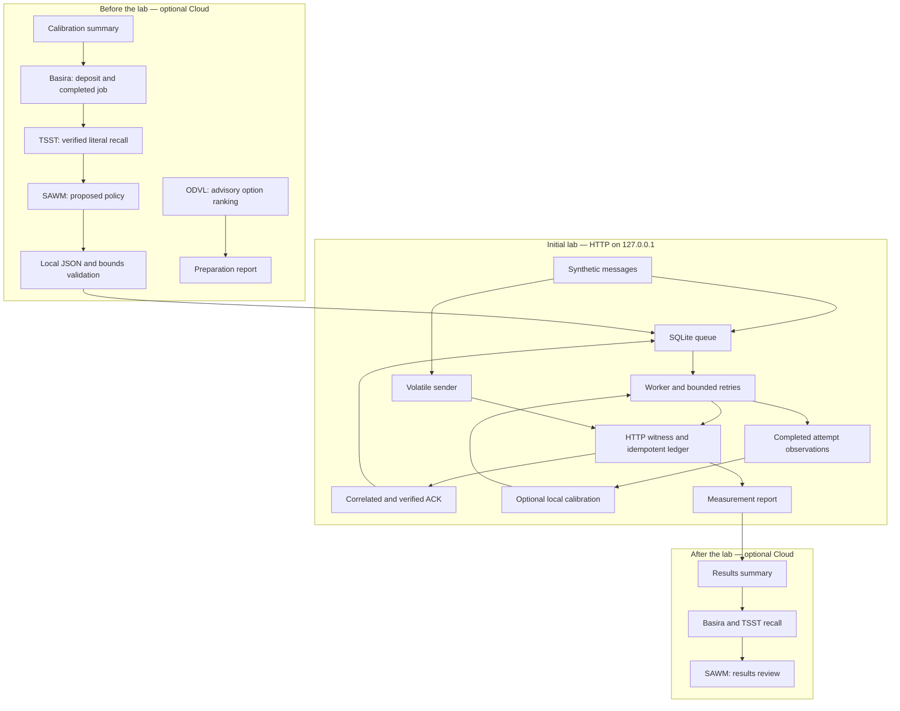

# SAWM Anti-Brouillage


[Article Medium — Français](docs/articles/SAWM-ANTI-BROUILLAGE-MEDIUM.md) · [Medium article — English](docs/articles/SAWM-ANTI-BROUILLAGE-MEDIUM-EN.md)

**Application resilience during outages — retain messages, resume delivery and verify each effect in an HTTP demonstrator.**

[Français](README.md) · [Quick start](#run-locally) · [Technical guide — French](docs/GUIDE-TECHNIQUE.md) · [Measured evidence](docs/measured-2026-10-27/) · [VM simulation and radio scope](docs/RADIO-VALIDATION.md#english-summary)

SAWM Anti-Brouillage is an executable demonstration of resilient HTTP delivery: a SQLite queue retains messages, a worker resumes attempts after restarting, and an idempotent recipient prevents a message from producing a second effect. It gives product and integration teams a concrete way to evaluate continuity before adapting the mechanism to their own service.

The Cloud workflow adds experiment memory through **Basira**, verified recall through **TSST**, advisory ranking through **ODVL**, and a bounded policy proposal from **SAWM**. During the experiment, optional **continuous local calibration** adjusts the HTTP timeout and retry delay using only completed attempts. Delivery remains local and independent; SAWM prepares the initial policy before execution.

## What you can evaluate

| Need | Demonstrated mechanism |
| --- | --- |
| Retain messages while the service is unavailable | Persistent SQLite queue and bounded retries |
| Resume after the sender process stops | Recovery from the same queue while preserving the attempt budget |
| Handle a missing response without repeating the effect | Stable identifier, content digest, recipient transaction and verified ACK |
| Adjust retries to observed HTTP behavior | Local calibration after every completed attempt, with persisted state and limits |
| Explain the outcome | Recipient ledger, attempt traces, JSON report and explicit checks |
| Retrieve calibration and results | Basira deposits, literal TSST recall and SAWM analysis before/after the run |

## A measured result with a defined scope

The [initial 27 October 2026 campaign](docs/measured-2026-10-27/benchmark.json) compares the same 20 messages across two channels on one local HTTP server. It injects a **2.009 s** service interruption, stops and restarts the worker, and deliberately drops an ACK after commit on each channel.

| Observation at the end of the run | Durable queue | Volatile sender, one attempt |
| --- | ---: | ---: |
| Unique effects recorded | **20 / 20** | **5 / 20** |
| ACKs received and verified | 20 | 4 |
| Messages without an effect | 0 | 15 |
| Duplicate requests received | 1 | 0 |
| Duplicated application effects | **0** | **0** |

All 14 report checks passed. The repeated request did not create a second effect. A missing ACK does not necessarily mean a missing effect: the deliberately dropped response tests this distinction.

**The local calibration without Cloud also achieved 20/20 with exactly the same policy.** These measurements show the benefit of the queue, retries and idempotent recipient under the lab's faults; they do not demonstrate a delivery improvement caused by Cloud. Both runs and their limits are [documented separately](docs/GUIDE-TECHNIQUE.md#preuves-conservées).

## Run locally

Requirements: **Python 3.10+** and an environment that allows a listener on `127.0.0.1` and child processes. The local lab uses only the Python standard library.

```sh
git clone https://github.com/SAWM-io/sawm-anti-brouillage.git
cd sawm-anti-brouillage
python3 -m venv .venv
. .venv/bin/activate
python lab.py --output-dir output/demo --messages 20 --policy examples/policy.json
```

Appropriate GitHub access is required. Use a new output directory for every run. The scenario normally takes a few seconds, within a 30-second overall budget. It starts its own HTTP server, stops it for two seconds, restarts the worker, then restores the server.

Read `output/demo/report.json` for results and `output/demo/measurements.json` for structured measurements. SQLite databases and logs remain available for inspection. Omitting `--messages` uses 10 messages; the supported range is 3–20 per channel.

```sh
# Local tests, including Cloud validators; no real API calls.
python -m pip install -r requirements.txt
python -m unittest discover -s tests -v
```

## Optional continuous calibration

Adaptive mode updates its parameters after each completed attempt. A verified ACK updates the latency estimate and its variation; a timeout increases the wait limit without being treated as a complete RTT sample. Timeouts and refusals space retries further apart; a connection closed without an ACK retains a bounded wait without assuming congestion. Successes bring retries closer. State and changes are persisted in SQLite and checked when the worker resumes.

Initial policy ceilings, maximum attempts and the overall budget remain fixed. Local calibration has no knowledge of future injected faults and does not estimate radio conditions. Static mode remains the default behavior of `lab.py`.

Compare both modes with the same synthetic workloads:

```sh
python adaptive_lab.py --output-dir output/adaptive-demo --repetitions 3 --messages 20
```

The [comparison method and limits — French](docs/GUIDE-TECHNIQUE.md#calibration-continue-locale) distinguish controller observations from policy assumptions prepared before the run. Better performance is not assumed: the report also retains regressions and attempt costs.

### Local comparison results

The [27 October loopback comparison](docs/measured-adaptive-2026-10-27/) includes 24 runs: four profiles, two modes and three repetitions. **Every run delivers and acknowledges 20/20 messages with no duplicated effects.** The values below are means of the ACK-delay p95 values calculated separately for each of the three runs per mode.

| HTTP profile | Fixed: mean ACK p95 | Adaptive: mean ACK p95 | Attempts per run, fixed / adaptive |
| --- | ---: | ---: | ---: |
| Normal service | 34.90 ms | 34.12 ms | 20 / 20 |
| Latency increase and recovery | 588.35 ms | 609.36 ms | 20 / 22 |
| ACK lost after commit | 149.49 ms | 153.89 ms | 28 / 28 |
| Outage and worker restart | 974.77 ms | 1113.07 ms | 22 / 25 |

**Calibration works, but this campaign does not show a general performance improvement.** Adaptive mode uses 285 attempts versus 270 for fixed mode, with 240 messages per mode; fixed mode has a lower mean ACK p95 on three of the four measured profiles. Three repetitions do not establish general superiority. Static mode remains the default, while adaptive mode lets teams examine these tradeoffs with complete traces.

The [individual measurements](docs/measured-adaptive-2026-10-27/aggregate.json), [delay chart](docs/measured-adaptive-2026-10-27/ack-p95.svg) and [calibration examples](docs/measured-adaptive-2026-10-27/figures/calibration-examples.svg) are retained. The first version and its lost-ACK regression remain [documented in the guide — French](docs/GUIDE-TECHNIQUE.md#correction-documentée-après-la-première-comparaison).

## Emulate a degraded link in a Linux VM

`vm_netem_lab.py` sends real TCP/HTTP packets between two isolated Linux network namespaces connected by a `veth` pair. `tc netem` applies this schedule **in each direction**:

| Scheduled phase | Injected network parameters |
| --- | --- |
| 0–1 s — healthy | 1 ms delay, no injected loss |
| 1–3 s — degraded | 60 ± 20 ms delay and 3% random loss |
| 3–4 s — blackout | 100% loss |
| From 4 s — recovery | Return to 1 ms delay, no injected loss |

The lab compares three fixed and three adaptive runs, with 20 messages per run. It uses the internal `198.18.0.0/30` subnet without a default route or an external link; the VM's primary interfaces do not receive these rules. Each pair uses the same contents, arrivals and parameters, but random packet-loss draws are not identical.

Inside a Linux VM with Python 3.10+, `iproute2` (`ip`, `tc`), network namespaces and `netem`, run from the repository root:

```sh
sudo python3 vm_netem_lab.py --output-dir output/vm-netem-demo --repetitions 3 \
  --policy docs/measured-2026-10-27/cloud/policy.json
```

The output directory must be new. Root privileges are used to create and remove the lab's isolated network resources. The archived SAWM policy is read locally: no new Cloud call is made. The [VM guide — French](docs/GUIDE-TECHNIQUE.md#émulation-réseau-dans-une-vm-linux) explains measurements during degradation, blackout and recovery.

This experiment emulates degraded IP communication. It does not model RF propagation, measure RSSI or SNR, or prove resistance to a physical jammer. The distinction is explained in the [network and radio validation document](docs/RADIO-VALIDATION.md#english-summary).

### What the VM experiment observed

The [real Linux campaign](docs/measured-vm-2026-10-27/) completed six runs in 46.001 s: **all 120 messages eventually produced a unique effect and received a verified ACK**. Behavior during each phase remains visible:

| Observation | Fixed mode | Adaptive mode |
| --- | --- | --- |
| Verified ACKs during degradation, r1 / r2 / r3 | 4 / 2 / 5 | 4 / 2 / 4 |
| Effects and ACKs in the stabilized blackout | 0 effects, 0 ACKs in every run | 0 effects, 0 ACKs in every run |
| First ACK after recovery, r1 / r2 / r3 | 105.35 / 653.46 / 200.27 ms | 124.44 / 84.49 / 31.97 ms |
| Unique effects and ACKs at completion | 60 / 60 | 60 / 60 |
| Total attempts | 69 | 73 |
| Mean of ACK-delay p95 values | 1708.60 ms | 1820.95 ms |

Confirmations continue during partial degradation. No new effect or verified ACK is recorded in the stabilized blackout; the queue retains messages for recovery. One ACK in the third fixed run is recorded at the boundary, 62.83 ms after blackout application: its message had been accepted beforehand. It remains in the traces and is excluded from the stabilized window, which starts after a 200 ms guard period.

The first post-recovery ACK can arrive sooner without improving the overall p95: these metrics describe different aspects of recovery. These six runs do not show a general adaptive advantage. The [detailed phase results — French](docs/GUIDE-TECHNIQUE.md#résultats-mesurés-dans-la-vm) retain events, transitions and attempt costs.

## Architecture and Cloud responsibilities



- **Basira** stores the small summaries supplied by the lab; receipts and job completion are checked.
- **TSST** retrieves those summaries. The validator requires the expected canonical text within evidence marked as integrity verified, in the correct space and entity.
- **ODVL** ranks three delivery options before the run. The order is validated and retained for inspection; the code does not apply it to the worker or pass it into SAWM's policy prompt.
- **SAWM** proposes an initial policy JSON object before the run and later reviews the measurements. Only the specified fields and bounds are accepted; no generated command is executed.

None of these calls is part of the delivery loop. The archived campaign includes real Cloud calls; the `cloud_access: false` field describes the corresponding lab execution, separate from the Cloud steps.

## Use Basira and SAWM

The [complete Cloud walkthrough](docs/GUIDE-TECHNIQUE.md#parcours-cloud) includes calibration, preparation, execution and result-recording commands. It requires `httpx` from `requirements.txt`, a Basira space, an explicitly authorized entity and an existing key with **`events:write`, `jobs:read`, `tsst:recall`, `odvl:rank`, `sawm:run`** for the complete workflow. Effective access grants on the entity are also required.

The key is read from a private file outside the repository with `600` permissions. The accepted API endpoint is `https://basira-api.sawm.io/api/v1/basira`. Cloud commands require `--run` and may incur charges. Send only the small synthetic measurements described in the guide.

## Scope and next steps

This is a demonstration lab running on one host. It tests a process restart with SQLite state retained during the same host boot. It does not validate machine reboot recovery, power failure, storage corruption or third-party API idempotency. Delays include the wait experienced by retained messages; they do not establish faster networking or higher bandwidth. The Mac and VMs support software validation; no radio equipment, vehicle or physical network is tested. The [future radio protocol](docs/RADIO-VALIDATION.md#english-summary) describes an isolated two-radio link, controlled attenuation and the required measurements, with no jammer deployed.

Explore the [technical guide — French](docs/GUIDE-TECHNIQUE.md), [validation checklist — French](docs/validation.md) and [27 October evidence](docs/measured-2026-10-27/). For HTTP message scheduling and deadlines, see the complementary [SAWM Smart Réseau](https://github.com/SAWM-io/sawm-smart-reseau) program.
