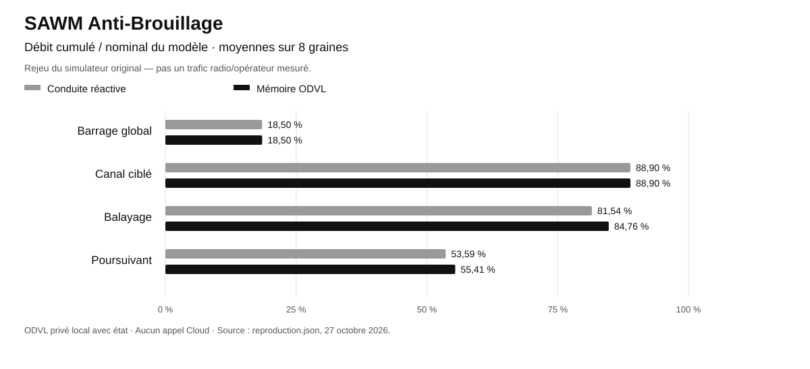
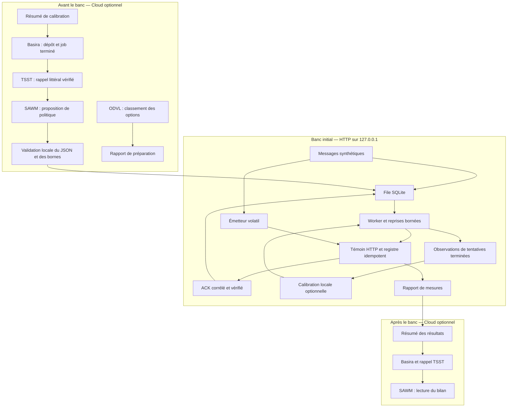

# SAWM Anti-Brouillage

**Dépôt public SAWM-io.** Aucune clé ni configuration privée n’est incluse. Les identifiants des preuves sont pseudonymisés ; les moteurs restent privés. [Périmètre de publication](PUBLICATION.md).


[Article Medium — Français](docs/articles/SAWM-ANTI-BROUILLAGE-MEDIUM.md) · [Medium article — English](docs/articles/SAWM-ANTI-BROUILLAGE-MEDIUM-EN.md)

**Résilience applicative aux coupures — conserver les messages, reprendre leur envoi et vérifier chaque effet dans un démonstrateur HTTP.**

[English](README.en.md) · [Secteurs et valeur client](#secteurs-et-valeur-client) · [Positionnement](#notre-positionnement-face-aux-solutions-existantes) · [Démarrage](#démarrer-en-local) · [Guide technique](docs/GUIDE-TECHNIQUE.md) · [Preuves mesurées](docs/measured-2026-10-27/) · [Simulation VM et portée radio](docs/RADIO-VALIDATION.md)

SAWM Anti-Brouillage est un démonstrateur exécutable de livraison HTTP résiliente : une file SQLite conserve les messages, un worker reprend les tentatives après son redémarrage et un destinataire idempotent évite de répéter l'effet d'un message. Il donne aux équipes produit et intégration un cas concret pour évaluer la continuité d'un échange applicatif avant d'adapter ce mécanisme à leur service.

Le parcours Cloud ajoute une mémoire des essais avec **Basira**, un rappel vérifié avec **TSST**, un classement consultatif avec **ODVL** et une proposition de politique bornée par **SAWM**. Pendant l'essai, un mode optionnel de **calibration continue locale** ajuste le timeout HTTP et le délai entre reprises à partir des seules tentatives terminées. La livraison reste locale et autonome ; SAWM prépare la politique initiale avant l'exécution.

## Nouveau : poursuivre le transfert en changeant de chemin


Le banc du **28 octobre 2026** bloque A, puis A+B, puis A+B+C, change le chemin encore disponible, puis coupe tous les chemins avant de les rétablir. **Le programme choisit ses alternatives à partir des retours réseau, sans recevoir le calendrier des coupures.** Deux nœuds Linux s'envoient chacun un fichier distinct : le retour transporte des données, pas seulement des ACK.

**Trois passages adaptatifs : 1 320 blocs sur 1 320 confirmés, six fichiers reçus à l'identique, aucun effet doublé.** De nouvelles données arrivent dans les deux sens à chacune des 18 phases de perturbation partielle. Les deux passages témoins restés sur A ne reçoivent aucune nouvelle donnée pendant ces phases ; ils récupèrent néanmoins leurs fichiers après le rétablissement. La différence démontrée est donc la continuité sur les chemins disponibles.

Si tous les chemins sont coupés, le transfert s'arrête et la file conserve les données jusqu'à la reprise. Le dashboard montre les choix, les confirmations, l'attente et les empreintes des fichiers. Les relevés du noyau et un vérificateur indépendant complètent les traces.

**Périmètre : quatre chemins IP virtuels entre deux espaces réseau dans une VM.** Le sélecteur est local ; cet essai ne mesure pas l'apport du Cloud ou d'ODVL, ni une résistance au brouillage radio physique. Les bascules ont un délai mesuré et ne garantissent pas une connexion sans interruption.

[Résultats et traces](docs/measured-multipath-2026-10-28/) · [Lancer le banc et le dashboard](docs/MULTIPATH-BIDIRECTIONNEL.md) · [English guide](docs/MULTIPATH-BIDIRECTIONAL.en.md)

## Secteurs et valeur client

**Une coupure de liaison ne devrait pas obliger une équipe à recommencer son travail.** SAWM Anti-Brouillage fournit une base exécutable pour conserver les données en attente, sélectionner un autre chemin disponible et vérifier ce qui arrive au destinataire.

Les cas ci-dessous sont des **applications proposées pour un pilote client**. Les mécanismes sont démontrés dans les bancs publiés ; leurs bénéfices métier et leur intégration aux équipements du client restent à mesurer. Le dépôt ne contient pas déjà un connecteur pour chacun de ces métiers.

| Secteur / acheteur | Cas concret à intégrer | Ce que le client cherche à gagner |
| --- | --- | --- |
| **Industrie, usines et maintenance** | Une passerelle transmet des mesures, journaux et photos d'inspection. Si un accès devient indisponible, elle utilise un autre chemin configuré ou conserve les envois jusqu'au retour du réseau. | Moins de reprises manuelles et de déplacements pour récupérer les données ; un diagnostic alimenté par les mesures effectivement reçues. |
| **Logistique, transport et entrepôts** | Des scans de colis, preuves de livraison et événements de suivi attendent pendant une zone sans couverture, puis rejoignent le système central avec des identifiants stables. | Moins de ressaisies, une meilleure continuité du suivi des colis et des échanges import/export ; distinguer un événement en attente d'un événement livré. |
| **Cybersécurité, SOC et supervision** | Un collecteur envoie les alertes et journaux vers le centre de supervision malgré la perte d'un chemin réseau. | Réduire les trous de visibilité liés au transport ; disposer des confirmations de réception pour l'enquête. Cette fonction transporte les alertes : elle ne détecte pas elle-même une intrusion. |
| **Énergie, eau, agriculture et sites isolés** | Des équipements transmettent leurs relevés et historiques après des interruptions de liaison, sans demander à un opérateur de relancer chaque envoi. | Moins d'observations perdues dans le flux applicatif, un suivi plus régulier et moins d'interventions de collecte. |
| **Intégrateurs IoT et fabricants de passerelles** | Adapter les composants de file, reprise et validation au service du client, puis reproduire les coupures dans le banc avant livraison. | Réutiliser une base documentée et testable ; réduire le travail de prototypage et remettre des preuves compréhensibles au client final. |
| **Télécoms et réseaux privés** | Évaluer une application disposant de plusieurs accès, comparer un chemin fixe et une sélection adaptative, puis examiner délais, reprises et livraison. | Identifier les conditions où un accès de secours est utile et dimensionner un pilote à partir de mesures. Les accès fibre, cellulaires ou satellite réels nécessitent leurs propres raccordements et essais. |
| **Robotique civile et équipements mobiles** | Récupérer des journaux, cartes ou résultats d'inspection lorsqu'un équipement traverse des zones de connectivité variable. | Moins de transferts à recommencer et une meilleure récupération des données de mission. La commande de sûreté, la téléopération et la vidéo continue ne sont pas validées par ces essais. |
| **Défense et infrastructures critiques — partenariat R&D** | Évaluer la continuité de télémétrie et de comptes rendus autorisés entre plusieurs chemins, avec traces des coupures et des reprises. | Construire un dossier de qualification reproductible. Une promesse de résistance au brouillage radio demande un banc radio isolé et une validation sur les équipements concernés. |

**Premiers pilotes recommandés : intégration industrielle/IoT, logistique et supervision cyber**, sur des flux qui tolèrent une reprise de quelques secondes. Si tous les chemins sont indisponibles, aucune donnée ne peut traverser : elle attend la reprise, dans les limites de stockage et de tentatives configurées. La continuité dépend aussi de chemins de secours réellement disponibles.

## Notre positionnement face aux solutions existantes

La bascule réseau et les files persistantes existent déjà. Notre proposition est un **kit de continuité applicative vérifiable**, avec code du démonstrateur, scénarios reproductibles, reçus, contrôle d'intégrité des fichiers et dashboard des décisions. Il peut compléter une infrastructure existante.

| Solution / approche | Ce qu'elle apporte déjà | Où se place SAWM Anti-Brouillage |
| --- | --- | --- |
| **Cisco Catalyst SD-WAN** | Détection des tunnels défaillants et utilisation de transports alternatifs, selon la [documentation Cisco](https://www.cisco.com/c/en/us/td/docs/solutions/CVD/SDWAN/cisco-sdwan-design-guide.html). | Vérifier, au niveau de l'application, quels messages ont produit un effet et quels fichiers sont arrivés à l'identique. Le démonstrateur n'est pas un remplacement du routeur ou du VPN. |
| **Peplink SpeedFusion** | Agrégation de liaisons, redondance de paquets et bascule entre accès WAN, décrites par [Peplink](https://www.peplink.com/technology/speedfusion-bonding-technology/). | Fournir un banc inspectable de sélection de chemins et de livraison HTTP. Il ne réalise pas l'agrégation transparente de toutes les sessions réseau ni un changement de fréquence radio. |
| **MQTT et messageries persistantes** | Conservation et reprise de messages ; par exemple, les [sessions persistantes AWS IoT](https://docs.aws.amazon.com/iot/latest/developerguide/mqtt.html#mqtt-persistent-sessions) prennent en charge des clients intermittents. | Réunir des essais de reprise, de choix de chemin et de vérification du destinataire, avec des preuves exportables. Une file durable seule n'est pas une nouveauté propre à SAWM. |

**Pourquoi évaluer notre approche ?** Pour pouvoir suivre le parcours « observation → choix du chemin → tentative → réception vérifiée », adapter le mécanisme à un échange métier précis et reproduire les incidents avant déploiement. Le parcours Cloud optionnel ajoute l'historique des essais dans Basira, le rappel TSST, le classement consultatif ODVL et les propositions bornées de SAWM, selon le [rôle exact de chaque composant](#architecture-et-rôle-du-cloud). La boucle locale de livraison reste opérationnelle sans appel Cloud.

Les mesures publiées comparent notre sélection adaptative à un chemin fixe, **pas aux produits ci-dessus**. Elles n'établissent ni une supériorité commerciale générale ni un gain du Cloud dans le banc à quatre chemins. Les moteurs privés ne sont pas distribués ; le parcours Cloud nécessite des accès autorisés.

### Du démonstrateur au pilote client

1. Choisir un flux utile : scans de colis, mesures, journaux ou pièces d'inspection, avec son délai acceptable et ses règles de confidentialité.
2. Raccorder les émetteurs, destinataires et chemins du client ; vérifier sécurité des échanges, stockage et traitement idempotent du destinataire.
3. Comparer à la solution actuelle avec les mêmes données et les mêmes coupures : livraison complète, intégrité, effets doublés, temps de reprise, consommation de ressources et interventions humaines.
4. Fixer ensemble les critères de réception et le périmètre du déploiement. Les économies de temps et de coûts se chiffrent sur ce pilote ; aucun pourcentage de retour sur investissement n'est supposé ici.

[Explorer les API Basira / SAWM](https://basira.sawm.io/) · [Reproduire le banc à quatre chemins](docs/MULTIPATH-BIDIRECTIONNEL.md) · [Lire les preuves](docs/measured-multipath-2026-10-28/)

## Reproduire les résultats du rapport



Le rapport **« Le Réseau qui se souvient »** repose sur un autre banc que les essais HTTP ci-dessous. Son protocole original est maintenant rejoué avec le **moteur ODVL privé réel**, ses empreintes et ses traces. Les moteurs privés ne sont pas distribués dans ce dépôt.

**16 canaux simulés, 8 graines × 1 200 pas** : réactif → ODVL, balayage **81,54 % → 84,76 %**, poursuivant **53,59 % → 55,41 %**. Il s’agit du débit relatif du modèle, pas de mesures RF. Le barrage global et le canal ciblé donnent des égalités.

[Protocole et chiffres](docs/reference-report-2026-10-27/) · [Visualisation autonome](docs/reference-report-2026-10-27/index.html) · [Démonstration en direct VM → Mac](docs/DEMONSTRATION-LIVE.md)

La démonstration en direct vérifie une livraison réelle et un changement entre deux chemins IP virtuels. Son contrôleur est local : il ne mesure pas l’apport d’ODVL.

Ce rejeu utilise ODVL avec état local, sans nouvel appel Cloud ni bras TSST. Il ne remplace pas une validation radio physique ou sur réseau opérateur.

## Ce que vous pouvez évaluer

| Besoin | Mécanisme démontré |
| --- | --- |
| Conserver les messages lorsque le service est indisponible | File SQLite persistante et nouvelles tentatives bornées |
| Reprendre après l'arrêt du processus émetteur | Récupération de la même file et conservation du budget de tentatives |
| Traiter une réponse perdue sans doubler l'effet | Identifiant stable, digest du contenu, transaction du destinataire et ACK vérifié |
| Ajuster la reprise aux observations HTTP | Calibration locale après chaque tentative terminée, avec état et limites persistés |
| Expliquer les résultats | Registre destinataire, traces de tentatives, rapport JSON et contrôles explicites |
| Retrouver une calibration et un bilan | Dépôt Basira, rappel littéral TSST et lecture SAWM avant/après l'essai |

## Un résultat mesuré, dans un périmètre précis

La [campagne initiale du 27 octobre 2026](docs/measured-2026-10-27/benchmark.json) compare les mêmes 20 messages sur deux canaux du même serveur HTTP local. Elle provoque une coupure de **2,009 s**, un arrêt puis une reprise du worker et la perte volontaire d'un ACK après commit dans chaque canal.

| Observation à la clôture | File durable | Envoi volatil, une tentative |
| --- | ---: | ---: |
| Effets uniques enregistrés | **20 / 20** | **5 / 20** |
| ACK reçus et vérifiés | 20 | 4 |
| Messages sans effet | 0 | 15 |
| Requêtes reçues en double | 1 | 0 |
| Effets applicatifs dupliqués | **0** | **0** |

Les 14 contrôles du rapport sont vrais. Une requête répétée n'a donc pas créé un second effet. L'absence d'ACK ne signifie pas nécessairement l'absence d'effet : c'est précisément ce que teste la réponse volontairement perdue.

**La calibration locale sans Cloud obtenait aussi 20/20, avec exactement la même politique.** Ces mesures montrent le bénéfice de la file, des reprises et du destinataire idempotent face aux fautes du banc ; elles ne démontrent aucun gain de livraison causé par le Cloud. Les deux exécutions et leurs limites sont [documentées séparément](docs/GUIDE-TECHNIQUE.md#preuves-conservées).

## Démarrer en local

Prérequis : **Python 3.10+**, un environnement permettant d'ouvrir un port sur `127.0.0.1` et de lancer des processus enfants. Le banc local utilise uniquement la bibliothèque standard Python.

```sh
git clone https://github.com/SAWM-io/sawm-anti-brouillage.git
cd sawm-anti-brouillage
python3 -m venv .venv
. .venv/bin/activate
python lab.py --output-dir output/demo --messages 20 --policy examples/policy.json
```

Le démonstrateur est consultable publiquement. Utilisez un nouveau répertoire de sortie à chaque essai. Le scénario dure normalement quelques secondes, avec un budget global de 30 secondes. Il crée son propre serveur HTTP, le coupe pendant deux secondes, redémarre le worker puis restaure le serveur.

Consultez `output/demo/report.json` pour les résultats et `output/demo/measurements.json` pour les mesures structurées. Les bases SQLite et les journaux restent disponibles pour l'analyse. Sans `--messages`, le banc utilise 10 messages ; il accepte de 3 à 20 messages par canal.

```sh
# Tests locaux, y compris les validateurs Cloud ; aucun appel API réel.
python -m pip install -r requirements.txt
python -m unittest discover -s tests -v
```

## Calibration continue optionnelle

Le mode adaptatif ajuste ses paramètres après chaque tentative terminée. Un ACK vérifié met à jour l'estimation de latence et sa variation ; un timeout fait augmenter le délai d'attente sans être assimilé à une mesure RTT complète. Les timeouts et refus espacent les reprises ; une connexion fermée sans ACK conserve une attente bornée, sans supposer une congestion. Les succès rapprochent les reprises. L'état et les changements sont enregistrés dans SQLite et vérifiés lors de la reprise du worker.

Les plafonds de la politique initiale, le nombre maximal de tentatives et le budget global restent fixes. La calibration locale n'utilise ni les prochaines fautes du scénario, ni une estimation de conditions radio. Le mode statique reste le comportement par défaut de `lab.py`.

Pour comparer les deux modes sur les mêmes charges synthétiques :

```sh
python adaptive_lab.py --output-dir output/adaptive-demo --repetitions 3 --messages 20
```

La [méthode et les limites de la comparaison](docs/GUIDE-TECHNIQUE.md#calibration-continue-locale) distinguent les observations utilisées par le contrôleur des hypothèses de politique préparées avant l'essai. Un meilleur résultat n'est pas supposé : le rapport conserve aussi les régressions et les coûts en tentatives.

### Résultat de la comparaison locale

La [campagne comparative en loopback du 27 octobre](docs/measured-adaptive-2026-10-27/) comprend 24 passages : quatre profils, deux modes, trois répétitions. **Chaque passage livre et acquitte 20/20 messages, sans effet dupliqué.** Les valeurs ci-dessous sont les moyennes des p95 de délai jusqu'à ACK, calculés séparément dans les trois passages de chaque mode.

| Profil HTTP | Fixe : p95 ACK moyen | Adaptatif : p95 ACK moyen | Tentatives par passage, fixe / adaptatif |
| --- | ---: | ---: | ---: |
| Service normal | 34,90 ms | 34,12 ms | 20 / 20 |
| Hausse de latence puis retour | 588,35 ms | 609,36 ms | 20 / 22 |
| ACK perdu après commit | 149,49 ms | 153,89 ms | 28 / 28 |
| Coupure puis reprise du worker | 974,77 ms | 1113,07 ms | 22 / 25 |

**La calibration fonctionne, mais cette campagne ne montre pas de gain général de performance.** Le mode adaptatif demande 285 tentatives contre 270 en fixe pour 240 messages par mode ; le p95 ACK moyen est inférieur en mode fixe sur trois des quatre profils mesurés. Trois répétitions ne permettent pas d'établir une supériorité générale. Le mode statique reste le défaut, et le mode adaptatif permet d'étudier ces compromis avec des traces complètes.

Les [mesures individuelles](docs/measured-adaptive-2026-10-27/aggregate.json), le [graphique des délais](docs/measured-adaptive-2026-10-27/ack-p95.svg) et les [exemples de recalibration](docs/measured-adaptive-2026-10-27/figures/calibration-examples.svg) sont conservés. La première version et sa régression sur les ACK perdus restent [documentées dans le guide](docs/GUIDE-TECHNIQUE.md#correction-documentée-après-la-première-comparaison).

## Émuler une liaison dégradée dans une VM Linux

`vm_netem_lab.py` fait circuler de vrais paquets TCP/HTTP entre deux espaces réseau Linux isolés, reliés par une paire `veth`. `tc netem` applique le scénario suivant **dans chaque sens** :

| Phase prévue | Paramètres réseau injectés |
| --- | --- |
| 0 à 1 s — nominal | Délai de 1 ms, sans perte injectée |
| 1 à 3 s — dégradation | Délai de 60 ± 20 ms et 3 % de pertes aléatoires |
| 3 à 4 s — coupure | 100 % de pertes |
| Dès 4 s — reprise | Retour au délai de 1 ms, sans perte injectée |

Le banc compare trois passages fixes et trois adaptatifs, avec 20 messages par passage. Il utilise le sous-réseau interne `198.18.0.0/30`, sans route par défaut ni liaison extérieure ; les interfaces principales de la VM ne reçoivent pas ces règles. Les mêmes contenus, arrivées et paramètres sont utilisés dans chaque paire, mais les tirages aléatoires de perte ne sont pas identiques.

Dans une VM Linux disposant de Python 3.10+, d'`iproute2` (`ip`, `tc`), des namespaces réseau et de `netem`, depuis la racine du dépôt :

```sh
sudo python3 vm_netem_lab.py --output-dir output/vm-netem-demo --repetitions 3 \
  --policy docs/measured-2026-10-27/cloud/policy.json
```

Le répertoire doit être nouveau. Les privilèges root servent à créer puis supprimer les ressources réseau isolées du banc. La politique SAWM archivée est lue localement : aucun nouvel appel Cloud n'est effectué. Le [guide VM](docs/GUIDE-TECHNIQUE.md#émulation-réseau-dans-une-vm-linux) explique les mesures pendant la dégradation, la coupure et la reprise.

Cette expérience émule une communication IP dégradée. Elle ne simule pas la propagation RF, ne mesure ni RSSI ni SNR et ne prouve pas une résistance à un brouilleur physique. La différence est précisée dans la [validation réseau et radio](docs/RADIO-VALIDATION.md).

### Ce qui a été observé dans la VM

La [campagne Linux réelle](docs/measured-vm-2026-10-27/) a terminé six passages en 46,001 s : **120 messages sur 120 ont finalement produit un effet unique et reçu un ACK vérifié**. Le comportement pendant les phases reste visible :

| Observation | Mode fixe | Mode adaptatif |
| --- | --- | --- |
| ACK vérifiés pendant la dégradation, r1 / r2 / r3 | 4 / 2 / 5 | 4 / 2 / 4 |
| Effets et ACK dans la coupure stabilisée | 0 effet, 0 ACK dans chaque passage | 0 effet, 0 ACK dans chaque passage |
| Premier ACK après retour, r1 / r2 / r3 | 105,35 / 653,46 / 200,27 ms | 124,44 / 84,49 / 31,97 ms |
| Effets uniques et ACK à la clôture | 60 / 60 | 60 / 60 |
| Tentatives totales | 69 | 73 |
| Moyenne des p95 jusqu'à ACK | 1708,60 ms | 1820,95 ms |

Des confirmations continuent pendant la dégradation partielle. Pendant la coupure stabilisée, aucun nouvel effet ni ACK vérifié n'est observé ; la file conserve les messages pour la reprise. Un ACK du troisième passage fixe est enregistré à la frontière, 62,83 ms après l'application de la coupure : son message avait été accepté avant celle-ci. Il est conservé dans les traces et exclu de la fenêtre stabilisée, qui commence après une garde de 200 ms.

Le délai du premier ACK après retour peut être plus court sans que le p95 global le soit : les métriques mesurent des aspects différents. Ces six passages ne montrent pas de gain général du mode adaptatif. Les [résultats détaillés par phase](docs/GUIDE-TECHNIQUE.md#résultats-mesurés-dans-la-vm) conservent les événements, les transitions et les différences de coût.

## Architecture et rôle du Cloud



- **Basira** conserve les petits résumés fournis par le laboratoire ; les reçus et la fin des jobs sont contrôlés.
- **TSST** rappelle ces résumés. Le validateur exige le texte canonique attendu dans une preuve marquée intègre, avec le bon espace et la bonne entité.
- **ODVL** classe trois options de livraison avant l'essai. L'ordre est validé et conservé à titre consultatif ; le code ne l'applique pas au worker et ne le transmet pas au prompt de politique SAWM.
- **SAWM** propose avant l'essai un JSON de politique initiale et produit ensuite une lecture des mesures. Le code accepte uniquement les champs et bornes prévus ; il n'exécute aucune commande générée.

Aucun de ces appels ne se trouve dans la boucle de livraison. La campagne archivée contient de vrais appels Cloud ; le champ `cloud_access: false` décrit le banc concerné, exécuté séparément des étapes Cloud.

## Utiliser Basira et SAWM

Le [parcours Cloud complet](docs/GUIDE-TECHNIQUE.md#parcours-cloud) fournit les commandes de calibration, préparation, essai et enregistrement du bilan. Il nécessite `httpx` via `requirements.txt`, un espace Basira, une entité explicitement autorisée et une clé existante avec les scopes **`events:write`, `jobs:read`, `tsst:recall`, `odvl:rank`, `sawm:run`** pour le parcours complet. Les droits effectifs sur l'entité restent nécessaires.

La clé se lit depuis un fichier privé hors du dépôt, de permissions `600`. L'URL API acceptée est `https://basira-api.sawm.io/api/v1/basira`. Les commandes Cloud exigent `--run` et peuvent être facturées. Envoyez uniquement les petites mesures synthétiques prévues dans le guide.

## Périmètre et suite du parcours

Le dépôt contient plusieurs bancs distincts. Le banc initial sur boucle locale teste un redémarrage de processus avec conservation de SQLite pendant le même démarrage de l'hôte. Le banc à quatre chemins utilise deux espaces réseau isolés dans une VM Linux ; l'essai antérieur VM → Mac relie deux machines via un tunnel SSH partagé. Ces essais ne valident ni un redémarrage de machine, ni une panne électrique, ni la corruption de stockage, ni l'idempotence d'une API tierce. Les délais incluent l'attente des messages conservés ; ils ne mesurent pas un gain de débit ou de vitesse réseau. Le Mac et les VM permettent la validation logicielle ; aucun équipement radio, véhicule ou réseau physique n'est testé. Le [protocole radio futur](docs/RADIO-VALIDATION.md) décrit une liaison isolée entre deux radios, une atténuation contrôlée et les mesures nécessaires, sans brouilleur déployé.

Pour approfondir : [guide technique](docs/GUIDE-TECHNIQUE.md), [grille de validation](docs/validation.md) et [preuves du 27 octobre](docs/measured-2026-10-27/). Pour explorer l'ordonnancement de messages HTTP et les échéances, voir le programme complémentaire [SAWM Smart Réseau](https://github.com/SAWM-io/sawm-smart-reseau).
