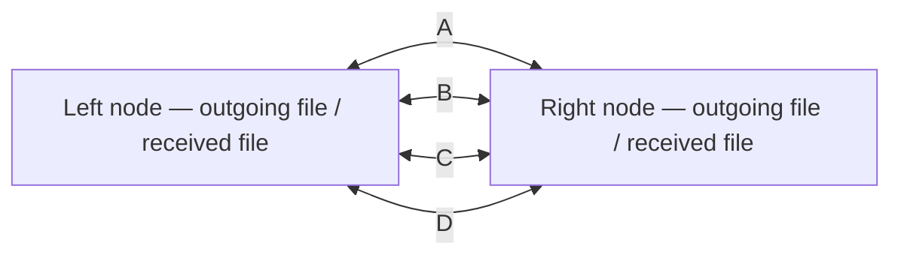

# Four paths, two directions of data transfer

[Français](MULTIPATH-BIDIRECTIONNEL.md) · [README](../README.en.md) · [Campaign evidence](measured-multipath-2026-10-28/)

This experiment answers a specific question: **when the path in use stops working, can the program find another path and actually continue transferring data?**

Two isolated Linux nodes each send a distinct synthetic file in chunks. Four virtual links, A, B, C and D, connect their network namespaces directly. The harness impairs these links with `tc netem` in both directions. File data and acknowledgements use these links; neither travels through a supervision channel.



## How the program chooses a path

Each node has its own selector. It uses verified acknowledgements, measured delays and failures already observed. It receives neither the current impairment phase nor the future outage schedule.

- A failed path is temporarily set aside while another is tried.
- Rolling observations of latency and success help compare the paths.
- A margin avoids switching for insignificant changes.
- Bounded probes allow the selector to rediscover restored paths.
- If every path fails, chunks remain in the queue. Retries are spaced out and remain subject to the experiment's budget.

Every attempt records its selected path and reason. This is a deterministic, adaptive local controller, not an LLM call for each packet. The optional Cloud workflow in other experiments remains described in the README. This campaign does not measure the contribution of Basira, TSST or ODVL to path selection.

## What counts as evidence

An interface changing colour is not sufficient. The report checks separately:

1. The network rules actually applied and their application times, with kernel qdisc readbacks retained in diagnostics.
2. Attempts that start **after** a cut and receive verified acknowledgements **before** the next phase, in both directions.
3. **New unique chunks committed by each recipient**. An acknowledgement for an old, repeated chunk does not count as new data.
4. The reconstructed file's SHA-256 against the expected file, independently in each direction.
5. Repeated requests and the absence of duplicated application effects.
6. Preservation of the VM's primary network and removal of resources created by the lab.

The standard scenario blocks A, then A+B, then A+B+C. It moves the surviving path, degrades it, blocks all four paths, then restores them. A second scenario changes the order of available paths. The `fixed_a` reference remains on A and uses the same durable queue: the useful comparison is continuity **during** partial outages, not merely eventual recovery after service returns.

A successful final `fixed_a` report means that files were eventually delivered and its stated checks passed. It does not mean that this reference maintained transfers during partial outages. Compare `phase_metrics[].directions[].new_effects` and `new_bytes`, as well as the first new acknowledgement delay.

## Run in an isolated Linux VM

Requirements: Python 3.10+, `iproute2` (`ip` and `tc`), Linux support for network namespaces, `veth` and `netem`, and root access for creating the lab's own network resources. This experiment uses the Python standard library. Run it only in a VM that you control.

```sh
git clone https://github.com/SAWM-io/sawm-anti-brouillage.git
cd sawm-anti-brouillage
python3 -m unittest discover -s tests -p 'test_multipath*.py' -v
```

Create a dedicated experiment token **outside the repository**. It is not a Basira Cloud key. This command will refuse to overwrite an existing token and will not print its value:

```sh
umask 077
mkdir -p "$HOME/.config/sawm"
python3 - "$HOME/.config/sawm/multipath-demo.token" <<'PY'
from pathlib import Path
import secrets
import sys
path = Path(sys.argv[1])
with path.open("x", encoding="ascii") as stream:
    stream.write(secrets.token_hex(32) + "\n")
path.chmod(0o600)
PY
```

Both nodes read that private file. The program requires a regular file with permissions `600`; do not place its content in a shell argument, report, Git commit or browser page.

Run each experiment into a **new output directory**. The default workload is 220 chunks of 4,096 bytes in each direction, generated every 250 ms. Generation lasts approximately 55 seconds; the overall budget is 105 seconds. These are configured limits, not guarantees of delivery.

```sh
sudo python3 multipath_vm_lab.py --run \
  --token-file "$HOME/.config/sawm/multipath-demo.token" \
  --output-dir "$HOME/.local/state/sawm-multipath/adaptive-standard-01" \
  --policy adaptive --scenario standard

sudo python3 multipath_vm_lab.py --run \
  --token-file "$HOME/.config/sawm/multipath-demo.token" \
  --output-dir "$HOME/.local/state/sawm-multipath/fixed-standard-01" \
  --policy fixed_a --scenario standard

sudo python3 multipath_vm_lab.py --run \
  --token-file "$HOME/.config/sawm/multipath-demo.token" \
  --output-dir "$HOME/.local/state/sawm-multipath/adaptive-staggered-01" \
  --policy adaptive --scenario staggered

sudo python3 multipath_vm_lab.py --run \
  --token-file "$HOME/.config/sawm/multipath-demo.token" \
  --output-dir "$HOME/.local/state/sawm-multipath/fixed-staggered-01" \
  --policy fixed_a --scenario staggered
```

The `--run` flag is required before network provisioning. Resources have fresh, uniquely generated names. The nodes have only loopback and four directly connected lab links, with no default route. No rule is installed on the VM's primary interface.

The same workload and impairment profiles are used for each policy. Random packet-loss draws and operating-system scheduling are not identical between runs; this comparison does not claim perfectly paired packet-level noise.

### Scenario timing

| Planned start | Standard scenario | Staggered scenario |
| --- | --- | --- |
| 0 s | All paths available | All paths available |
| 6 s | A blocked | Only C available |
| 12 s | A+B blocked | Only B available |
| 18 s | Only D available | Only D available |
| 24 s | Only B available | A+B blocked |
| 30 s | Only C available | Only C available |
| 36 s | Only C available, degraded | Only C available, degraded |
| 42 s | All paths blocked | All paths blocked |
| 47 s | All paths restored | All paths restored |

A blocked path has 100% injected loss in both directions. During the degraded phase, C has 35 ± 5 ms of configured delay and 2% random loss per direction. The report retains actual application timestamps; nominal timing in this table is not a measured result.

## Read-only dashboard on localhost

The dashboard serves only the four public JSON proof files and its own page. It cannot change the network, launch a process or send file data around an impaired path. Keep it bound to localhost.

While the experiment is running, use a second terminal **inside the VM**. The lab creates its output directory with restricted permissions, so this live viewer needs access to that directory:

```sh
sudo python3 multipath_dashboard.py \
  --data-dir "$HOME/.local/state/sawm-multipath/adaptive-standard-01" \
  --port 8895
```

If the browser is on your Mac, use your own existing SSH alias for the VM:

```sh
ssh -N -o ExitOnForwardFailure=yes \
  -L 127.0.0.1:8895:127.0.0.1:8895 vm-lab
```

Open **http://127.0.0.1:8895/** on the Mac. `vm-lab` is an example alias; no personal address or SSH key is supplied by the repository. This optional tunnel carries dashboard telemetry, not the experiment's file data.

For an archived run copied to a readable local directory, root is unnecessary:

```sh
python3 multipath_dashboard.py --data-dir /absolute/path/to/archived-run --port 8895
```

The dashboard displays current or completed state, selected paths, attempts, received chunks, pending data and integrity results. Old telemetry must not be mistaken for a live connection. It reports public decision reasons, not hidden thoughts of a language model.

## Inspect and keep the results

- `report.json`: scope, source hashes, phase metrics, reconstructed-file hashes, checks and cleanup results.
- `progress.json`: atomically updated status for the viewer.
- `attempts.json`: path, times, outcome and selection reason for every attempt in both directions.
- `phase-events.json`: requested profiles and actual application times.
- `received-left.bin` / `received-right.bin`: actual reconstructed synthetic files.
- `left.sqlite` / `right.sqlite`: durable queues and recipient ledgers.
- `setup-cleanup-private.json` / `topology-private.json`: raw network diagnostics, kept private until reviewed before publication.

The report's `left` direction means left → right; the corresponding received file is `received-right.bin`. The two nodes use the same host's monotonic clock, avoiding subtraction between clocks on different machines.

Retain failures and partial runs as well as successful runs. An interrupted experiment, a missing phase or a failed cleanup check must not be reported as validated. Unit tests validate code properties; they do not replace execution in Linux.

## Scope of the demonstration

These are real TCP/HTTP transfers between two isolated network nodes in **one Linux VM**. The four links are virtual and share its hardware. This experiment does not measure radio bands, SNR or physical jamming. The 16-channel numerical radio model and the earlier VM → Mac demonstration remain separate experiments.

When no path can reach the recipient, the program cannot remain connected. It can retain data and resume later. Detection delays, probes and retries may cause interruptions; completion depends on the configured budgets and a path becoming available again.

Deployment on real equipment requires authorised interface observations and controls, genuinely independent paths, and measured switching and transfers on that hardware. The public laboratory supports software validation before that step.
