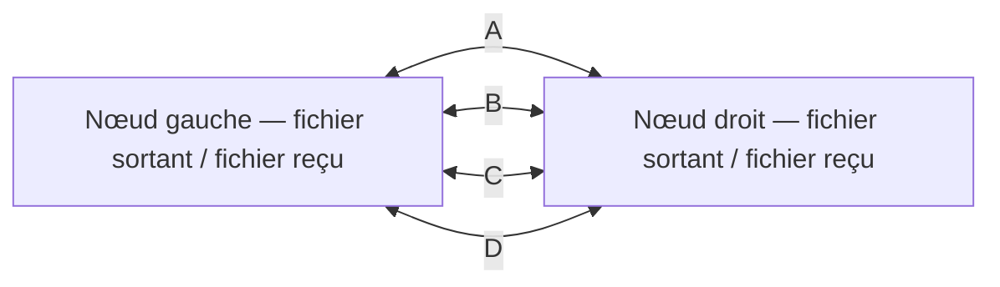

# Quatre chemins, deux sens de transfert

Ce banc répond à une question précise : **si le chemin utilisé cesse de fonctionner, le programme trouve-t-il un autre chemin et poursuit-il réellement le transfert ?**

Deux nœuds Linux isolés échangent chacun un fichier synthétique découpé en blocs. Quatre liaisons virtuelles A, B, C et D relient directement leurs espaces réseau. Le banc perturbe ces liaisons avec `tc netem`, dans les deux sens. Les données et leurs confirmations empruntent ces liaisons ; elles ne passent pas par le canal de supervision.



## Comment le programme choisit

Chaque nœud dispose de son propre sélecteur. Il utilise les confirmations vérifiées, les délais mesurés et les échecs déjà constatés. Il ne reçoit ni la phase courante ni le calendrier des futures coupures.

- Un chemin qui échoue est temporairement écarté ; un autre est essayé.
- Une moyenne des délais et des succès permet de comparer les chemins déjà observés.
- Une marge évite de changer de chemin pour une variation insignifiante.
- Des sondes bornées permettent de redécouvrir un chemin rétabli.
- Si tous les chemins échouent, les blocs restent dans la file. Les tentatives sont espacées et soumises à un budget.

Le choix et sa raison sont journalisés. Il s'agit d'un contrôleur local déterministe et adaptatif, pas d'un appel au LLM à chaque paquet. Le rôle Cloud optionnel des autres bancs du dépôt reste documenté dans le README. Cette campagne ne mesure pas l'apport de TSST, de Basira ou d'ODVL au choix des chemins.

## Ce qui constitue une preuve

Un changement de couleur dans une interface ne suffit pas. Le rapport vérifie séparément :

1. Les règles réseau réellement appliquées et leur instant d'application.
2. Les tentatives qui commencent **après** la coupure et sont confirmées **avant** la phase suivante, dans chaque sens.
3. Les blocs uniques enregistrés par chaque destinataire.
4. L'empreinte SHA-256 du fichier reconstruit comparée au fichier attendu.
5. Les requêtes répétées et l'absence d'effet applicatif doublé.
6. La conservation du réseau principal de la VM et le nettoyage des ressources du banc.

Le scénario bloque successivement A, puis A+B, puis A+B+C. Il déplace ensuite le chemin encore utilisable, le dégrade, coupe les quatre chemins, puis les rétablit. Une variante change l'ordre des chemins disponibles. Le témoin `fixed_a` reste sur A et utilise la même file : on compare ainsi la continuité pendant les coupures, pas seulement le nombre final de fichiers récupérés après rétablissement.

## Lancer dans une VM Linux

Prérequis : Python 3.10+, `iproute2` (`ip`, `tc`), namespaces, `veth` et `netem`. Aucun paquet Python supplémentaire ni accès Cloud n'est nécessaire. Les privilèges root servent à créer puis nettoyer les ressources réseau dédiées ; utiliser une VM de laboratoire contrôlée.

Créer un jeton de test hors du dépôt, sans afficher sa valeur :

```sh
umask 077
mkdir -p "$HOME/.config/sawm"
python3 - "$HOME/.config/sawm/multipath.token" <<'PY'
from pathlib import Path
import secrets, sys
path = Path(sys.argv[1])
with path.open('x', encoding='ascii') as stream:
    stream.write(secrets.token_hex(32) + '\n')
path.chmod(0o600)
PY
```

Depuis la racine de ce dépôt, lancer un passage dans un **nouveau** répertoire :

```sh
sudo python3 multipath_vm_lab.py --run \
  --token-file "$HOME/.config/sawm/multipath.token" \
  --output-dir "$HOME/sawm-multipath-01" \
  --policy adaptive --scenario standard
```

Le passage par défaut génère **220 blocs de 4 096 octets par sens**, espacés de 250 ms, sur environ 55 secondes. Le budget d'exécution est borné à 105 secondes. L'émetteur ne connaît pas à l'avance la disponibilité des quatre chemins. Pour comparer, lancer un autre passage avec `--policy fixed_a`, puis changer l'ordre avec `--scenario staggered`. Conserver chaque sortie, y compris un éventuel échec.

Consulter `report.json`, `attempts.json`, `phase-events.json` et `progress.json`. Les bases SQLite, fichiers reçus et diagnostics privés restent dans le dossier d'essai. Le statut `success` du témoin fixe valide sa livraison finale et son nettoyage ; il ne prétend pas valider une continuité pendant les coupures de A. Les métriques par phase permettent cette comparaison.

## Voir les bascules

Le dashboard est en lecture seule. Lui fournir un répertoire contenant les quatre JSON autorisés, ou une copie de ceux-ci mise à jour pendant le passage :

```sh
python3 multipath_dashboard.py --data-dir /chemin/vers/les/preuves --port 8895
```

Ouvrir `http://127.0.0.1:8895/`. Le serveur écoute exclusivement sur loopback, n'exécute aucune commande et ne diffuse ni jeton ni bases SQLite. Pendant un essai exécuté sur une autre machine, la copie de télémétrie doit être acheminée par un canal d'administration séparé. Elle ne remplace pas le transport des blocs mesuré par le banc.

Le dashboard distingue le dernier état récent, un état périmé et un passage terminé. Il affiche les perturbations appliquées, les choix publiés, les ACK, les nouvelles données reçues et l'intégrité finale. Les [preuves mesurées du 28 octobre](measured-multipath-2026-10-28/) permettent aussi une consultation historique.

## Périmètre de la démonstration

Ce sont de vrais transferts TCP/HTTP entre deux nœuds réseau isolés dans **une même VM Linux**. Les quatre liens sont virtuels et partagent son matériel. Ce banc ne mesure ni des bandes radio, ni le SNR, ni une émission de brouillage physique. Les mesures du rapport radio numérique à 16 canaux et la démonstration antérieure VM → Mac restent des expériences distinctes.

Quand aucun chemin ne permet de joindre le destinataire, le programme ne peut pas rester connecté. Il peut conserver les données et reprendre leur transfert. Les délais de détection, les sondes et les reprises peuvent provoquer des interruptions ; la livraison et le délai restent soumis aux budgets configurés et à la disponibilité ultérieure d'un chemin.

Pour un déploiement sur des équipements réels, il faut raccorder les observations et commandes de l'interface réseau autorisée, disposer de chemins effectivement indépendants, puis mesurer les bascules et les transferts sur ce matériel. Le banc public permet de valider la logique logicielle avant cette étape.
