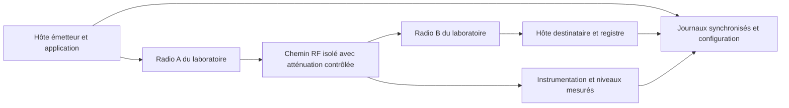

# Validation radio — protocole futur

[Présentation](../README.md) · [Guide technique](GUIDE-TECHNIQUE.md) · [English summary](#english-summary)

**Statut : protocole proposé, aucune mesure RF réalisée.** L'environnement disponible est un Mac avec possibilité de machines virtuelles. Il permet d'exécuter les tests logiciels et le banc HTTP, mais ne fournit ni liaison radio instrumentée, ni mesure de RSSI ou de SNR.

SAWM Anti-Brouillage démontre aujourd'hui la résilience applicative et l'ajustement local de paramètres de reprise à partir d'observations HTTP. Une erreur de connexion, un timeout ou une latence HTTP ne permet pas d'identifier un brouillage radio. Le code ne pilote pas d'émetteur RF.

## Ce qui peut être validé avec le Mac et des VM

| Question | Preuve possible aujourd'hui |
| --- | --- |
| Les messages survivent-ils à l'arrêt du worker ? | Même file SQLite reprise, traces des processus et registre destinataire |
| Un ACK perdu crée-t-il un second effet ? | Tentatives répétées comparées aux effets uniques du témoin |
| Les paramètres suivent-ils les observations terminées ? | Trace de calibration et rejeu des états |
| Le mode adaptatif fait-il mieux qu'une politique fixe ? | Comparaison appariée sur les profils HTTP locaux, avec résultats favorables et défavorables |
| Le programme résiste-t-il à une dégradation RF ? | Non mesuré : matériel radio et instrumentation nécessaires |

Une VM supplémentaire peut compléter ultérieurement les essais de transport IP. Elle ne transforme pas une simulation de délai ou de perte en mesure radio. Le banc livré reste limité à `127.0.0.1` ; il faudrait une extension de transport distincte pour traverser des VM ou une liaison physique.

## Montage de laboratoire envisagé

Utiliser une liaison entre **deux équipements radio appartenant au laboratoire**, isolée des réseaux tiers. Selon le matériel retenu, relier les ports RF par un chemin conduit avec atténuation réglable, ou placer la liaison dans une enceinte blindée validée. Prévoir les équipements d'analyse nécessaires pour mesurer les niveaux et vérifier l'isolement.

L'atténuation et les niveaux admis dépendent du matériel : ils doivent être définis à partir des notices et de l'étalonnage du montage, avant émission. Les exemples de boucle RF du constructeur Ettus illustrent la nécessité d'une atténuation adaptée à la protection des entrées ; leurs valeurs ne sont pas universelles. [Documentation constructeur Ettus](https://kb.ettus.com/Verifying_the_Operation_of_the_USRP_Using_UHD_and_GNU_Radio)

Ce protocole prévoit une dégradation par atténuation contrôlée. **Aucun brouilleur n'est déployé.** L'essai caractériserait la continuité applicative lorsque la liaison se dégrade ; l'atténuation seule ne permettrait pas de conclure à une résistance à toutes les formes d'interférence ou de brouillage.

## Comparaison à charge égale

Avant les essais, figer la configuration des radios, les versions, la puissance réglée, les gains, le canal, la largeur de bande, les éventuels mécanismes automatiques du lien et les limites du contrôleur applicatif. Documenter ce que le matériel expose effectivement comme RSSI, bruit et SNR, avec leurs unités et leur méthode de calcul. Une valeur non exposée doit rester « non mesurée ».

Comparer au minimum une livraison durable à politique fixe et la même livraison avec ajustement local activé. Conserver les mêmes contenus, tailles de messages, arrivées, charge offerte, budgets, calendrier d'atténuation et durée d'observation. Ajouter une référence sans dégradation. Alterner l'ordre des modes, répéter les essais et conserver aussi les échecs. Le contrôleur reçoit les seules observations accessibles à l'application ; il ne doit pas connaître les futures variations d'atténuation.

Les principes de mesure du débit, des délais et des pertes à configuration documentée peuvent s'appuyer sur la [RFC 2544](https://www.rfc-editor.org/info/rfc2544/). Le protocole présent n'en revendique pas la conformité et ne constitue pas une certification RF. Les essais de charge doivent rester sur le banc isolé : la [RFC 6815](https://www.rfc-editor.org/rfc/rfc6815.html) distingue ces benchmarks des réseaux de production.

## Mesures à conserver

| Niveau | Mesures et précautions d'interprétation |
| --- | --- |
| Configuration du lien | Modèles, versions, réglages, câblage, atténuation imposée, étalonnage et environnement |
| Radio | RSSI et SNR lorsqu'ils sont réellement disponibles, niveau de bruit, débit du lien, réessais et erreurs exposés par le matériel |
| Transport | Charge offerte, octets utiles reçus, pertes observées, RTT et variation des délais |
| Application | Effets uniques, ACK vérifiés, tentatives, effets dupliqués, messages restant en file, délais de livraison et de confirmation |
| Contrôleur | État initial, observations terminées, paramètres avant/après, limites et événements de reprise |
| Ressources et horloges | Charge CPU, activité disque, horloges utilisées et erreur de synchronisation si des délais entre hôtes sont calculés |

Rapporter le débit utile en précisant les octets et la fenêtre de mesure. Publier les latences médiane, p95 et maximum avec le nombre de messages concernés ; ne pas calculer un avantage à partir des seuls messages arrivés si les taux de livraison diffèrent. Pour un délai entre hôtes, mesurer la synchronisation des horloges ou préférer un RTT établi sur une seule horloge.

## Critères de conclusion

Définir les critères avant la campagne : absence d'effet supplémentaire, respect des limites, taux de livraison, coût en tentatives et délais acceptables. Un avantage du mode adaptatif doit être observé à charge égale sur plusieurs répétitions et accompagné de la dispersion, des cas défavorables et des réglages exacts.

Une conclusion recevable serait : « sur ce matériel, ce profil d'atténuation et cette charge, le mode adaptatif présente les résultats suivants ». Elle ne doit pas devenir une garantie générale « anti-brouillage ». Les preuves HTTP existantes et les futures preuves radio doivent être conservées dans des dossiers distincts.

## English summary

**Proposed protocol; no RF measurements have been performed.** The available Mac and virtual machines support software validation and local HTTP experiments. They do not establish RF interference resistance, RSSI or SNR performance. The current transport is fixed to loopback; a separate transport extension would be required for a physical link.

A future campaign would use two laboratory-owned radios in an isolated conducted or shielded setup, with equipment-specific input protection, controlled attenuation and calibrated instrumentation. No jammer is deployed. Attenuation tests characterize a degraded link and cannot establish resistance to every interference mechanism.

Compare fixed and adaptive delivery with identical payloads, offered load, timing, limits and attenuation profiles; include an undegraded baseline, alternate execution order and repeat runs. Record actual RSSI/SNR where available, useful throughput, latency, loss, retries, unique application effects, verified ACKs and controller traces. Report missing measurements, clock uncertainty, variability and unfavorable outcomes. Any conclusion must remain specific to the tested hardware and conditions.
