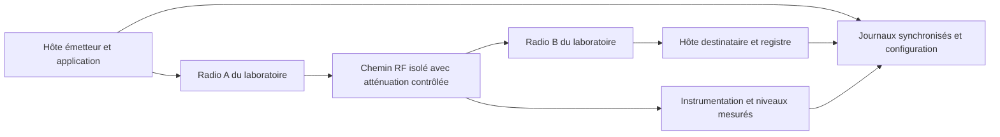

# Simulation réseau en VM et validation radio

[Présentation](../README.md) · [Guide technique](GUIDE-TECHNIQUE.md) · [English summary](#english-summary)

**Statut : essais HTTP et campagne réseau Linux en VM réalisés ; aucune mesure RF.** La VM fait circuler de vrais paquets avec des délais et des pertes imposés par `tc netem`. Elle ne fournit ni liaison radio instrumentée, ni mesure de RSSI ou de SNR. Le protocole physique proposé plus bas reste à réaliser.

SAWM Anti-Brouillage démontre aujourd'hui la résilience applicative et l'ajustement local de paramètres de reprise à partir d'observations HTTP. Une erreur de connexion, un timeout ou une latence HTTP ne permet pas d'identifier un brouillage radio. Le code ne pilote pas d'émetteur RF.

## Ce qui peut être validé avec le Mac et des VM

| Question | Preuve possible aujourd'hui |
| --- | --- |
| Les messages survivent-ils à l'arrêt du worker ? | Même file SQLite reprise, traces des processus et registre destinataire |
| Un ACK perdu crée-t-il un second effet ? | Tentatives répétées comparées aux effets uniques du témoin |
| Les paramètres suivent-ils les observations terminées ? | Trace de calibration et rejeu des états |
| Le mode adaptatif fait-il mieux qu'une politique fixe ? | Comparaison à charge et paramètres identiques ; pas de gain général établi, et pertes aléatoires non identiques dans la VM |
| Les messages sont-ils confirmés pendant une dégradation IP ? | Comptes par phase de la campagne Linux : confirmations partielles pendant la dégradation, puis reprise après la coupure |
| Le programme résiste-t-il à une dégradation RF ? | Non mesuré : matériel radio et instrumentation nécessaires |

L’extension `vm_netem_lab.py` utilise désormais deux namespaces Linux isolés, reliés par `veth` sur `198.18.0.0/30`, sans route extérieure. Le worker public reste limité à `127.0.0.1` ; seul ce banc adapte sa destination à une adresse interne fixe, après vérification de la topologie. Une simulation de délai ou de perte reste distincte d’une mesure radio.

## Ce que montre la campagne VM

Le [rapport Linux conservé](measured-vm-2026-10-27/report.json) contient six passages de 20 messages, trois fixes et trois adaptatifs. Les règles `netem` imposent dans chaque sens 60 ± 20 ms et 3 % de pertes entre 1 et 3 secondes, 100 % de pertes entre 3 et 4 secondes, puis un retour au profil nominal. La politique initiale SAWM est lue depuis l’archive locale ; aucun nouvel appel Cloud n’est réalisé. Les ajustements en cours d’essai proviennent du contrôleur local et des observations terminées.

Les 120 messages sont finalement livrés et acquittés sans effet dupliqué, mais le comportement pendant la panne est distinct du bilan final :

- Pendant la dégradation partielle, les passages adaptatifs reçoivent respectivement 4, 2 et 4 ACK vérifiés ; les passages fixes en reçoivent 4, 2 et 5.
- Dans la fenêtre de coupure stabilisée, les six passages enregistrent zéro effet et zéro ACK. La file conserve les messages jusqu’au retour de la communication.
- Le premier ACK après retour arrive après 124,44 / 84,49 / 31,97 ms en adaptatif et 105,35 / 653,46 / 200,27 ms en fixe. Ces valeurs ne mesurent pas le vidage complet de la file.
- Un ACK du troisième passage fixe est observé à la frontière de la coupure, avant la garde de 200 ms. Son message avait été accepté avant la coupure ; cet événement est conservé et ne prouve pas une communication à travers la coupure stabilisée.

Les 73 tentatives adaptatives contre 69 fixes, et le p95 ACK moyen plus élevé en adaptatif, ne montrent pas de gain général. Les tirages aléatoires de pertes ne sont pas appariés. Le [guide technique](GUIDE-TECHNIQUE.md#résultats-mesurés-dans-la-vm) donne les comptes, les délais et l’interprétation des transitions.

Pour reproduire dans une VM Linux équipée de Python 3.10+, `iproute2`, namespaces, `veth` et `netem`, avec un nouveau répertoire de sortie :

```sh
sudo python3 vm_netem_lab.py --output-dir output/vm-netem-demo --repetitions 3 \
  --policy docs/measured-2026-10-27/cloud/policy.json
```

Le banc émule des symptômes IP compatibles avec une communication dégradée. Il n’identifie pas leur cause et ne simule ni propagation RF, ni modulation, ni brouilleur. Il ne permet donc pas de mesurer une résistance physique au brouillage.

## Montage de laboratoire envisagé

Utiliser une liaison entre **deux équipements radio appartenant au laboratoire**, isolée des réseaux tiers. Selon le matériel retenu, relier les ports RF par un chemin conduit avec atténuation réglable, ou placer la liaison dans une enceinte blindée validée. Prévoir les équipements d'analyse nécessaires pour mesurer les niveaux et vérifier l'isolement.

L'atténuation et les niveaux admis dépendent du matériel : ils doivent être définis à partir des notices et de l'étalonnage du montage, avant émission. Les exemples de boucle RF du constructeur Ettus illustrent la nécessité d'une atténuation adaptée à la protection des entrées ; leurs valeurs ne sont pas universelles. [Documentation constructeur Ettus](https://kb.ettus.com/Verifying_the_Operation_of_the_USRP_Using_UHD_and_GNU_Radio)



Ce protocole prévoit une dégradation par atténuation contrôlée. **Aucun brouilleur n'est déployé.** L'essai caractériserait la continuité applicative lorsque la liaison se dégrade ; l'atténuation seule ne permettrait pas de conclure à une résistance à toutes les formes d'interférence ou de brouillage.

## Comparaison à charge égale

Avant les essais, figer la configuration des radios, les versions, la puissance réglée, les gains, le canal, la largeur de bande, les éventuels mécanismes automatiques du lien et les limites du contrôleur applicatif. Documenter ce que le matériel expose effectivement comme RSSI, bruit et SNR, avec leurs unités et leur méthode de calcul. Une valeur non exposée doit rester « non mesurée ».

Comparer au minimum une livraison durable à politique fixe et la même livraison avec ajustement local activé. Conserver les mêmes contenus, tailles de messages, arrivées, charge offerte, budgets, calendrier d'atténuation et durée d'observation. Ajouter une référence sans dégradation. Alterner l'ordre des modes, répéter les essais et conserver aussi les échecs. Le contrôleur reçoit les seules observations accessibles à l'application ; il ne doit pas connaître les futures variations d'atténuation.

Les principes de mesure du débit, des délais et des pertes à configuration documentée peuvent s'appuyer sur la [RFC 2544](https://www.rfc-editor.org/info/rfc2544/). Le protocole présent n'en revendique pas la conformité et ne constitue pas une certification RF. Les essais de charge doivent rester sur le banc isolé : la [RFC 6815](https://www.rfc-editor.org/rfc/rfc6815.html) distingue ces benchmarks des réseaux de production.

## Mesures à conserver

| Niveau | Mesures et précautions d'interprétation |
| --- | --- |
| Configuration du lien | Modèles, versions, réglages, câblage, atténuation imposée, étalonnage et environnement |
| Radio | RSSI et SNR lorsqu'ils sont réellement disponibles, niveau de bruit, débit du lien, réessais et erreurs exposés par le matériel |
| Transport | Charge offerte, octets utiles reçus, pertes observées, RTT et variation des délais |
| Application | Effets uniques, ACK vérifiés, tentatives, effets dupliqués, messages restant en file, délais de livraison et de confirmation |
| Contrôleur | État initial, observations terminées, paramètres avant/après, limites et événements de reprise |
| Ressources et horloges | Charge CPU, activité disque, horloges utilisées et erreur de synchronisation si des délais entre hôtes sont calculés |

Rapporter le débit utile en précisant les octets et la fenêtre de mesure. Publier les latences médiane, p95 et maximum avec le nombre de messages concernés ; ne pas calculer un avantage à partir des seuls messages arrivés si les taux de livraison diffèrent. Pour un délai entre hôtes, mesurer la synchronisation des horloges ou préférer un RTT établi sur une seule horloge.

## Critères de conclusion

Définir les critères avant la campagne : absence d'effet supplémentaire, respect des limites, taux de livraison, coût en tentatives et délais acceptables. Un avantage du mode adaptatif doit être observé à charge égale sur plusieurs répétitions et accompagné de la dispersion, des cas défavorables et des réglages exacts.

Une conclusion recevable serait : « sur ce matériel, ce profil d'atténuation et cette charge, le mode adaptatif présente les résultats suivants ». Elle ne doit pas devenir une garantie générale « anti-brouillage ». Les preuves HTTP existantes et les futures preuves radio doivent être conservées dans des dossiers distincts.

## English summary

**HTTP and Linux VM network experiments completed; no RF measurements performed.** The VM extension sends real TCP/HTTP packets through two isolated network namespaces and a `veth` link. Bidirectional `tc netem` applies 60 ± 20 ms delay with 3% random loss, a one-second 100% loss window, then recovery. The public worker remains loopback-only; the VM harness uses a fixed isolated destination. No new Cloud call is made: the initial SAWM policy is read from a local archive, and adaptation uses only completed local observations.

All 120 messages were eventually delivered and acknowledged. Some ACKs arrived during partial degradation; none arrived in the stabilized blackout. One boundary ACK belonged to a message accepted before blackout and is retained separately from the guarded window. Recovery timings, attempts and p95 values do not establish a general adaptive advantage. Random loss draws are not identical across modes. These are packet-level impairment results, not an RF propagation or interference model; RSSI and SNR are not measured.

A future campaign would use two laboratory-owned radios in an isolated conducted or shielded setup, with equipment-specific input protection, controlled attenuation and calibrated instrumentation. No jammer is deployed. Attenuation tests characterize a degraded link and cannot establish resistance to every interference mechanism.

Compare fixed and adaptive delivery with identical payloads, offered load, timing, limits and attenuation profiles; include an undegraded baseline, alternate execution order and repeat runs. Record actual RSSI/SNR where available, useful throughput, latency, loss, retries, unique application effects, verified ACKs and controller traces. Report missing measurements, clock uncertainty, variability and unfavorable outcomes. Any conclusion must remain specific to the tested hardware and conditions.
