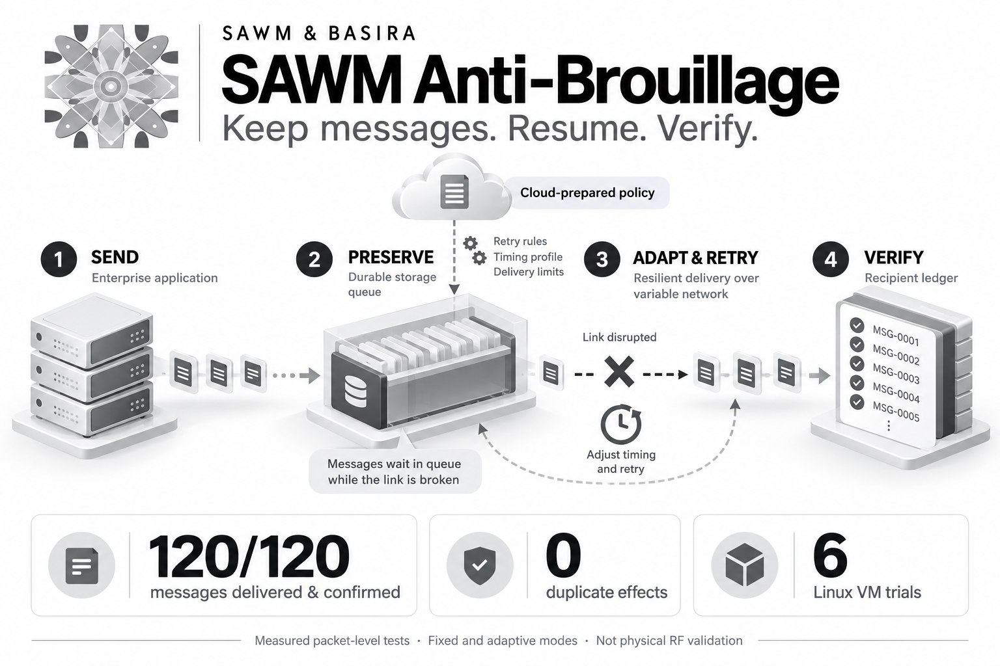

# SAWM Anti-Brouillage: retain messages, handle outages and verify recovery

An order, an inventory update, a production report: a message can have business consequences long after it leaves the sender. When the receiving service becomes unavailable, the team needs to know what was retained, what was applied and what still awaits confirmation. A missing response makes that distinction especially difficult.

**SAWM Anti-Brouillage provides an executable framework for investigating these situations.** It combines a persistent queue, bounded retries and a recipient that recognizes previously processed messages. It produces inspectable evidence for evaluating continuity between applications. Its current scope is HTTP, with local experiments and network impairment emulation inside a Linux virtual machine.

## What happens during an outage

The first result is concrete. Following a **2.009-second** service interruption and a sender process restart, durable delivery produces **20 unique effects from 20 messages**, compared with **5 from 20** for a volatile sender making one attempt. A repeated durable request after a missing confirmation creates no additional effect. The scenario, counters and checks are recorded in the [initial report](https://github.com/SAWM-io/sawm-anti-brouillage/blob/main/docs/measured-2026-10-27/benchmark.json).

For a business, this result suggests useful questions before integration. Does a task survive its process restarting? Can the recipient recognize an operation that was already applied when another attempt arrives? Does support have evidence explaining a pending message? These are evaluation criteria for service integration, event collection and deferred synchronization. Those business examples are potential adaptations, rather than claims about validated customer deployments.

The mechanism is straightforward. SQLite retains messages and their attempt history. Each message has a stable identifier and a digest of its contents. The recipient records the effect before confirming it; another attempt with the same contents retrieves that effect. The sender verifies the response before closing the message. This cooperation matters: a third-party API's behavior still needs separate verification. The [technical guide](https://github.com/SAWM-io/sawm-anti-brouillage/blob/main/docs/GUIDE-TECHNIQUE.md) describes the protocol and its boundaries.

## Cloud memory prepares; the local controller adapts

SAWM and Basira add preparation and experiment memory. Before a run, Basira stores a calibration summary and TSST enables verified recall. ODVL records an advisory ranking of delivery options. SAWM proposes an initial policy, accepted only if it satisfies local bounds. After the experiment, a results summary can be stored and reviewed. The executed operations are documented in the [Cloud evidence](https://github.com/SAWM-io/sawm-anti-brouillage/tree/main/docs/measured-2026-10-27/cloud).

During delivery, optional adaptive mode works locally. It adjusts response timeouts and retry spacing from completed attempts, without knowing when the next fault will occur. Cloud is not called between messages. The historical calibration without Cloud already achieved **20/20 with the same policy**, so the measurements do not establish a delivery improvement caused by Cloud. That reference remains available in the [calibration report](https://github.com/SAWM-io/sawm-anti-brouillage/blob/main/docs/measured-2026-10-27/calibration.json).

## 120 confirmed messages in the VM

The next experiment sent real HTTP packets inside a Linux VM. Two isolated network namespaces are connected only to each other. In both directions, the lab applies **60 ± 20 ms of delay and 3% random loss**, followed by **one second of total loss**, then link recovery. Six runs, split between fixed and adaptive policies, eventually deliver **all 120 messages**, with verified confirmations and no duplicated effects. The [VM report](https://github.com/SAWM-io/sawm-anti-brouillage/blob/main/docs/measured-vm-2026-10-27/report.json) records the parameters and results.

The sequence matters as much as the final total. Some confirmations continue during partial degradation. In the stabilized blackout window, no new effect or verified confirmation is observed. After the link returns, the first acknowledgement arrives between **31.97 and 124.44 ms** in the three adaptive runs, approximately **32–124 ms**. That measures the first confirmation, not complete queue drainage. A boundary acknowledgement associated with a message accepted before blackout is explicitly retained in the [phase-by-phase findings](https://github.com/SAWM-io/sawm-anti-brouillage/blob/main/docs/measured-vm-2026-10-27/README.md).

Adaptation does not establish general superiority in this campaign: it uses **73 attempts compared with 69** for fixed mode. Random packet-loss draws differ between runs, and repetitions are limited. The program makes those tradeoffs inspectable, including unfavorable outcomes preserved in the [aggregate measurements](https://github.com/SAWM-io/sawm-anti-brouillage/blob/main/docs/measured-vm-2026-10-27/aggregate.json).

## Try the program

To try the local lab, you need **Python 3.10 or later** and access to the repository. From a terminal:

```sh
git clone https://github.com/SAWM-io/sawm-anti-brouillage.git
cd sawm-anti-brouillage
python3 -m venv .venv
. .venv/bin/activate
python lab.py --output-dir output/demo --messages 20 --policy examples/policy.json
```

The [documented quick start](https://github.com/SAWM-io/sawm-anti-brouillage/blob/main/README.en.md#run-locally) uses the Python standard library. Every run requires a new output directory, preserving earlier evidence. For the optional Cloud workflow, install `requirements.txt` and follow the [setup instructions](https://github.com/SAWM-io/sawm-anti-brouillage/blob/main/docs/GUIDE-TECHNIQUE.md#parcours-cloud): an existing key in a private file outside the repository, an authorized entity and appropriate scopes. The local lab requires no secret credentials.

Network reproduction requires a Linux VM with `iproute2`, network namespaces and `netem`. The command uses root to create and clean up isolated lab resources; it reads the archived policy without making a new Cloud call:

```sh
sudo python3 vm_netem_lab.py --output-dir output/vm-demo --repetitions 3 \
  --policy docs/measured-2026-10-27/cloud/policy.json
```

The product name does not turn this evidence into radio protection. No RSSI, SNR or physical jammer is measured. Process recovery also does not validate queue recovery across a machine reboot. These boundaries are explained in the [network and radio scope document](https://github.com/SAWM-io/sawm-anti-brouillage/blob/main/docs/RADIO-VALIDATION.md#english-summary).

For a team preparing a pilot, the next step is practical: reproduce the experiments, select a business exchange, then verify its recipient and operating constraints. [SAWM Anti-Brouillage](https://github.com/SAWM-io/sawm-anti-brouillage) provides the code, measurements and evidence needed to begin that evaluation.
