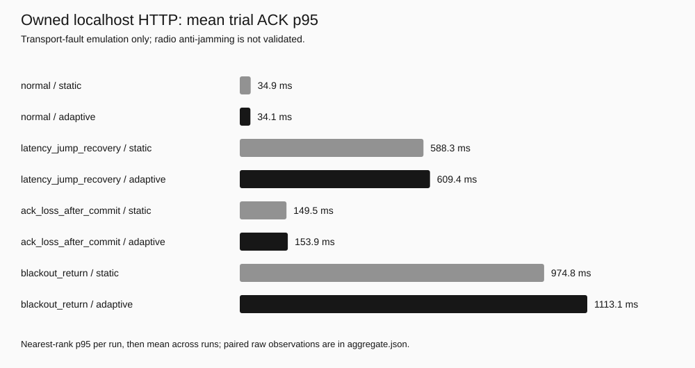
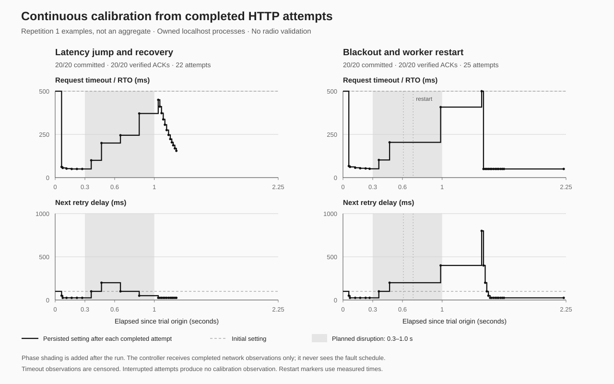

# Mesures de recalibration continue — 27 octobre 2026

**Résultat : 24 essais valides ; 480 messages livrés et acquittés, aucun effet applicatif doublé ni conflit de contenu.** Le mode fixe et le mode adaptatif ont chacun reçu 240 messages. Chaque mode a réussi les quatre profils, trois fois. Il ne s’agit pas de 480 messages indépendants d’une liaison radio.

Le banc a utilisé de vrais sockets HTTP et transactions SQLite sur le Mac (Darwin, arm64). Les défauts sont injectés par le serveur témoin local. Aucun équipement radio ou trafic traversant une VM n’a été mesuré. La politique initiale reprend le [JSON Cloud déjà conservé](../measured-2026-10-27/cloud/policy.json) ; cette nouvelle campagne ne fait aucun appel Cloud.

## Comparaison complète

Le délai est mesuré du début réel de mise en file à l’ACK vérifié. Chaque p95 utilise le rang le plus proche sur les 20 ACK du passage ; le tableau présente la moyenne de trois p95, pas un p95 de tous les messages regroupés. Les tentatives sont totalisées sur les trois passages.

| Profil | p95 fixe (ms) | p95 adaptatif (ms) | Tentatives fixes | Tentatives adaptatives |
| --- | ---: | ---: | ---: | ---: |
| Service normal | 34.90 | 34.12 | 60 | 60 |
| Hausse de latence puis reprise | 588.35 | 609.36 | 60 | 66 |
| ACK perdus après commit | 149.49 | 153.89 | 84 | 84 |
| Coupure et redémarrage du worker | 974.77 | 1113.07 | 66 | 75 |

**Aucun avantage général de rapidité n’est démontré.** Le mode fixe est plus rapide dans trois des quatre profils de cette campagne. L’adaptatif emploie 285 tentatives, contre 270 pour le fixe. Les variations d’ordonnancement de la machine et les trois répétitions bornent la portée du résultat. Le réglage statique reste le défaut.

## Ce qui est vérifié

- Le réglage évolue uniquement après une tentative terminée ; aucune phase future n’est fournie au worker.
- Le timeout et les délais de reprise restent dans les limites initiales ; le budget de temps et de tentatives n’est jamais augmenté.
- Les tentatives interrompues restent inconnues, sans inventer un résultat ou un échantillon de latence.
- La reprise conserve l’état calculé, les traces et les limites. Les reçus vérifiés correspondent à des effets enregistrés chez le destinataire.
- Chaque paire fixe/adaptatif utilise exactement les mêmes octets de messages et le même calendrier prévu. Le retard réel de mise en file est conservé ; les requêtes rencontrent les perturbations à des instants différents.

La figure montre deux passages, identifiés comme exemples. Le gris indique une phase de perturbation ajoutée après l’essai pour la lecture du graphique ; cette information n’entrait pas dans le contrôleur.

## Correction et historique conservés

La [première campagne](initial/report.json) utilisait `bounded-rto/v1`. Sur les pertes d’ACK, la moyenne des p95 adaptatifs atteignait 1048,78 ms contre 150,92 ms en fixe. Le contrôleur doublait une attente globale pour plusieurs connexions fermées sans ACK. Ce signal ne suffit pas à conclure à une congestion.

`bounded-rto/v2` conserve dans ce cas au moins l’attente initiale, sans la doubler ; une attente plus élevée justifiée par un timeout ou un refus reste conservée. La nouvelle moyenne est 153,89 ms, contre 149,49 ms en fixe. Les anciennes files gardent leur algorithme, et les 12 états adaptatifs initiaux se relisent sans changement. Les sources de la première campagne sont archivées dans [initial/source](initial/source).

## Pièces et reproduction

- [Rapport de campagne](report.json), [agrégats et différences appariées](aggregate.json), [manifest des artefacts](manifest.json).
- Les dossiers `r1-*`, `r2-*`, `r3-*` contiennent les messages fictifs, SQLite, journaux de worker, observations du témoin, états et traces de calibration. Leur contenu est synthétique et réservé au banc.
- [Validation logicielle](test-validation.json) : 41 tests réussis, sans appel Cloud réel. La comparaison n’est pas une certification réseau.
- [Guide et commandes](../GUIDE-TECHNIQUE.md#calibration-continue-locale), [protocole radio futur](../RADIO-VALIDATION.md).

Les manifestes d’origine sont conservés tels quels ; les figures et ce résumé ajoutés après la campagne sont couverts par le manifeste à la racine du dépôt. Une empreinte vérifie l’intégrité de fichiers conservés ; elle n’est pas une attestation d’un tiers.

## English summary

24 valid real-localhost HTTP trials delivered and acknowledged all 480 messages, with no duplicate ledger effects or content conflicts. Both static and adaptive modes delivered 240/240. Continuous calibration and process restart persistence are verified; a general speed benefit is not. Static is faster in three of these four profiles. No RF or VM-link measurement was performed. Initial and revised results are retained in full, including the corrected missing-ACK backoff regression.
