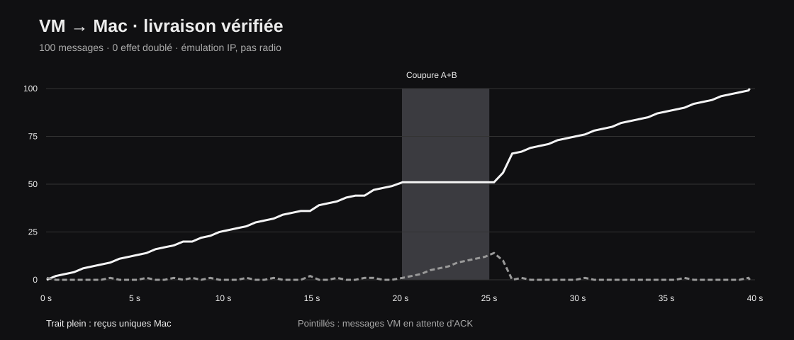

# VM → Mac : communication, panne et reprise vérifiées

Campagne finale du 27 octobre 2026 : **100 messages émis, 100 effets uniques enregistrés sur le Mac, 100 ACK corrélés, zéro effet doublé**. Une requête répétée a été reconnue sans appliquer un second effet. 117 tentatives, 39,78 secondes de scénario. Identifiant : `live-4a7d377ca1a04366a542ca6a155f13a0`.

## Ce qui a été effectivement mesuré

| Phase appliquée | ACK vérifiés dans la phase | Observation |
| --- | ---: | --- |
| Nominal | 13 | Livraison entre VM et Mac |
| A dégradé | 17 | La seconde voie est utilisée face au délai et aux pertes |
| A coupé | 20 | 19 ACK concernent des tentatives sur B commencées pendant cette phase ; le dernier provient d’une tentative antérieure |
| A + B coupés | 0 | Zéro ACK dans la coupure totale, y compris après la garde de 200 ms ; les messages attendent |
| Rétablissement | 50 | Premier ACK après 452,74 ms ; la file se vide |

Le sélecteur observe les réponses et les échecs : il ne reçoit pas le calendrier des fautes comme entrée de choix. Les **12 contrôles** du [rapport VM](vm/report.json) sont vrais : corrélation des ACK, phases, livraison de secours et reprise, budget, conservation du réseau principal, nettoyage, code inchangé. Les [reçus Mac](mac-receipts.sqlite) constituent un témoin distinct de l’émetteur ; sélectionner le `run_id` ci-dessus, car la base conserve aussi les essais préparatoires.

Les [historiques du dashboard](receiver-final-state.json) conservent les compteurs réellement reçus. Les courbes utilisent le temps monotone déclaré par la VM au moment du statut ; elles ne prétendent pas mesurer une latence entre deux horloges d’hôtes. Les délais de reprise et les ACK par phase sont calculés uniquement côté VM.

## Périmètre exact

Ubuntu Linux dans UTM → récepteur Python sur macOS. Deux paires veth et un namespace isolé utilisent `tc netem`, puis rejoignent **un même tunnel SSH**. Il s’agit d’effets IP réels sur ces liens virtuels, sans radio et sans deux accès physiques indépendants. Le canal de contrôle reste séparé des chemins de données injectés ; sa disponibilité n’est pas comptée comme une livraison.

La boucle de transport emploie un contrôleur local EWMA, des reprises bornées et un récepteur idempotent. **Aucun appel SAWM, Basira, TSST ou ODVL n’intervient dans cette boucle.** Les gains ODVL du rapport sont reproduits dans [le banc original à 16 canaux](../reference-report-2026-10-27/README.md), avec d’autres unités et un autre protocole.

[Installer et relancer la démonstration](../DEMONSTRATION-LIVE.md). Le dashboard actualise les compteurs, les chemins, les événements et l’état périmé ; il ne présente pas une ancienne télémétrie comme une connexion active.

## Essais préparatoires conservés

- [Démarrage DNS](diagnostic-first-start/) : livraison réussie mais phase de dégradation sautée. Horloge et résolution de noms corrigées ; la couverture des phases est désormais exigée.
- [VM interrompue](interrupted-second-run/) : arrêt UTM pendant le passage ; résultat incomplet conservé comme tel.
- [Course au nettoyage](diagnostic-cleanup-race/) : communication complète, contrôle final négatif parce que Linux avait déjà supprimé une interface. Vérification explicite d’absence ajoutée, avec test du cas où elle demeure.

73 tests locaux passent pour Anti-Brouillage, dont les régressions de démarrage et de nettoyage, les ACK, le témoin persistant et les contrôles du dashboard. Le JavaScript est valide. Le navigateur automatisé était désactivé dans les réglages de l’application : les lancements et observations ont donc été vérifiés par les mêmes API HTTP locales, sans revendiquer un test de clics dans Chrome.
