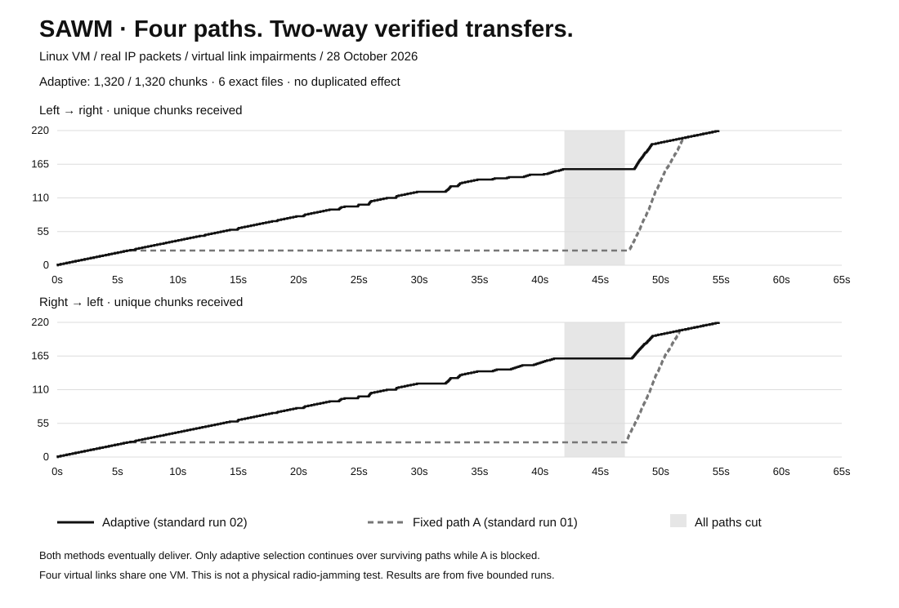

# Quatre chemins : preuve de bascule et de transfert bidirectionnel

**28 octobre 2026 · Linux 6.8 · Python 3.10 · deux nœuds isolés dans une VM.**



**Résultat : le programme trouve automatiquement d'autres chemins lorsqu'une partie des liens est bloquée, et les transferts continuent dans les deux sens.** Sur les trois passages adaptatifs : **1 320/1 320 blocs confirmés, six fichiers exacts, 5 406 720 octets utiles reçus et aucun effet doublé**. Chacune des 18 phases de perturbation partielle contient de nouvelles données reçues dans les deux sens.

Quand les quatre liens sont coupés, aucun nouveau bloc ne traverse le réseau dans la fenêtre stabilisée. Les files conservent les données et les transferts reprennent au retour du réseau. Les deux témoins bloqués sur A récupèrent aussi tous leurs fichiers après rétablissement : la preuve d'adaptation est la **progression pendant les coupures partielles**, pas uniquement le taux final de livraison.

## Cinq passages complets

Chaque passage envoie deux fichiers distincts de **220 blocs × 4 096 octets**, soit 880 Kio par fichier. Les nouvelles données sont générées toutes les 250 ms ; le budget global est de 105 secondes.

| Passage | Blocs confirmés | Nouveaux blocs reçus pendant les perturbations partielles, deux sens cumulés | Phases partielles avec progression dans les deux sens | Tentatives |
| --- | ---: | ---: | ---: | ---: |
| [Adaptatif, standard 01](adaptive-standard-01/report.json) | 440/440 | 267 | 6/6 | 494 |
| [Fixe A, standard 01](fixed-standard-01/report.json) | 440/440 | 0 | 0/6 | 627 |
| [Adaptatif, standard 02](adaptive-standard-02/report.json) | 440/440 | 262 | 6/6 | 497 |
| [Adaptatif, ordre différent](adaptive-staggered-01/report.json) | 440/440 | 267 | 6/6 | 496 |
| [Fixe A, ordre différent](fixed-staggered-01/report.json) | 440/440 | 0 | 0/6 | 643 |

Douze requêtes répétées ont atteint les destinataires dans les passages adaptatifs ; elles ont été reconnues sans répéter l'effet. Les compteurs de requêtes répétées et d'effets uniques sont distincts.

## Ce qui arrive au réseau

| Début prévu | Scénario standard | Variante |
| --- | --- | --- |
| 0 s | Quatre chemins disponibles | Identique |
| 6 s | A coupé | C seul disponible |
| 12 s | A+B coupés | B seul disponible |
| 18 s | D seul disponible | Identique |
| 24 s | B seul disponible | A+B coupés |
| 30 s | C seul disponible | Identique |
| 36 s | C seul, dégradé : délai 35 ± 5 ms et 2 % de perte par sens | Identique |
| 42 s | A+B+C+D coupés à 100 % | Identique |
| 47 s | Quatre chemins rétablis | Identique |

Les horodatages réels d'application sont dans chaque `phase-events.json`. Le contrôleur ne reçoit pas ce calendrier : il observe les ACK vérifiés, les échecs et les délais. Chaque nœud fait ses propres choix. Les liaisons sont de vraies interfaces Linux `veth` ; les pertes sont injectées par `tc netem` dans les deux sens.

## Les délais observés

La première nouvelle confirmation après rétablissement total arrive entre **229 et 804 ms** dans les passages adaptatifs. Lors des changements de phase partielle, cette mesure varie entre **60 et 3 566 ms**. Ce n'est pas un RTT ni une garantie de bascule instantanée : le délai inclut la prochaine tentative, les échecs, les sondes et le transfert confirmé. La meilleure valeur peut concerner un chemin déjà disponible et sélectionné avant le changement.

La file évite de perdre les données en attente, mais elle ne supprime ni les pauses ni les budgets de tentative. La courbe compare deux passages nommés, pas une moyenne ni une mesure de débit maximal. Les cinq passages ne démontrent pas une supériorité sur MPTCP, QUIC multipath ou d'autres algorithmes adaptatifs.

## Des preuves qui se recoupent

- `report.json` : résultat, empreintes, sources testées, écritures reçues et mesures par phase.
- `attempts.json` : choix, motif public, début/fin et résultat de chaque tentative.
- `phase-events.json` : perturbations et fenêtres réellement appliquées.
- `kernel-readback.json` : lecture du noyau des **72 configurations par passage**, avec nœud et chemin ; aucun secret ni adresse d'administration.
- `independent-validation.json` : vérification séparée des bases SQLite originales, de chaque reçu, des fichiers binaires, des paramètres noyau et des empreintes du code.
- `progress.json` : état final pour le dashboard. Quand présent, `history` contient les états réellement relevés par la supervision ; les périodes non relevées ne sont pas inventées.

**112 tests logiciels passent.** Les trois passages adaptatifs passent chacun 28 vérifications ; les deux références passent chacune 12 vérifications de livraison finale et de nettoyage. La référence fixe ne possède volontairement pas de critère de continuité sur un chemin qu'elle ne sait pas quitter. Les 360 configurations noyau sont vérifiées indépendamment.

Les métriques de continuité exigent un ACK pour une tentative commencée après application du profil et terminée avant le suivant, ainsi qu'une nouvelle écriture du destinataire opposé. Une garde de 200 ms écarte les frontières dans les comptages stabilisés. Les fenêtres de transition restent dans les traces. Un ACK de doublon ne suffit donc pas à prouver qu'un nouveau bloc a traversé le réseau.

## Reproduire et consulter

Suivre le [guide français](../MULTIPATH-BIDIRECTIONNEL.md) ou l'[English guide](../MULTIPATH-BIDIRECTIONAL.en.md). Le vérificateur indépendant s'exécute sur le dossier original d'un passage, qui contient ses SQLite et fichiers reçus :

```sh
python3 verify_multipath_evidence.py --data-dir /chemin/prive/du/passage
python3 multipath_dashboard.py \
  --data-dir docs/measured-multipath-2026-10-28/adaptive-staggered-01 --port 8895
```

Le dashboard présente alors **un passage terminé**, avec les courbes, les décisions et les preuves ; il ne prétend pas que cette campagne historique est toujours en cours. Pour voir un essai actuel, le pointer sur les JSON d'une exécution active. Les fichiers privés originaux restent hors du dépôt. Un premier lancement préparatoire n'a pas pu démarrer parce que la VM avait été arrêtée ; il ne fait pas partie de ces cinq mesures complètes.

## Périmètre exact

Les deux nœuds et les quatre chemins partagent **une VM et son matériel**. Ce test ne valide pas une liaison RF, des bandes physiques, une résistance à un brouilleur réel, ni une indépendance matérielle des liens. Le contrôleur est local, sans appel Cloud et sans ODVL dans cette boucle ; l'apport des moteurs Cloud n'est pas testé ici. Le rejeu numérique ODVL du rapport et la démonstration VM → Mac restent des expériences séparées dans ce dépôt.

Le réseau principal a été conservé et les ressources créées ont été nettoyées dans les cinq passages. L'adaptation n'ouvre aucun accès à un réseau tiers et ne change pas les interfaces principales.

## English summary

Three adaptive runs confirmed **1,320/1,320 data chunks**, reconstructed six exact files and delivered fresh data in **both directions in all 18 partially impaired phases**. Two fixed-A references delivered no new data during those phases, but recovered their complete files once A returned. All-path outages stopped delivery; queues retained data for recovery. First new ACK after full recovery: **229–804 ms**; partial-phase delays reached **3,566 ms**.

Each run transfers two distinct 880 KiB synthetic files over four virtual Linux paths. Receiver writes, valid ACKs, file hashes and all **360 kernel configuration readbacks** across the five runs were checked. This is an IP resilience experiment on one VM, not physical radio-jamming validation. The observation-only selector does not receive the fault schedule, and its performance is not attributed to Cloud or ODVL. [Machine-readable summary](summary.json).
