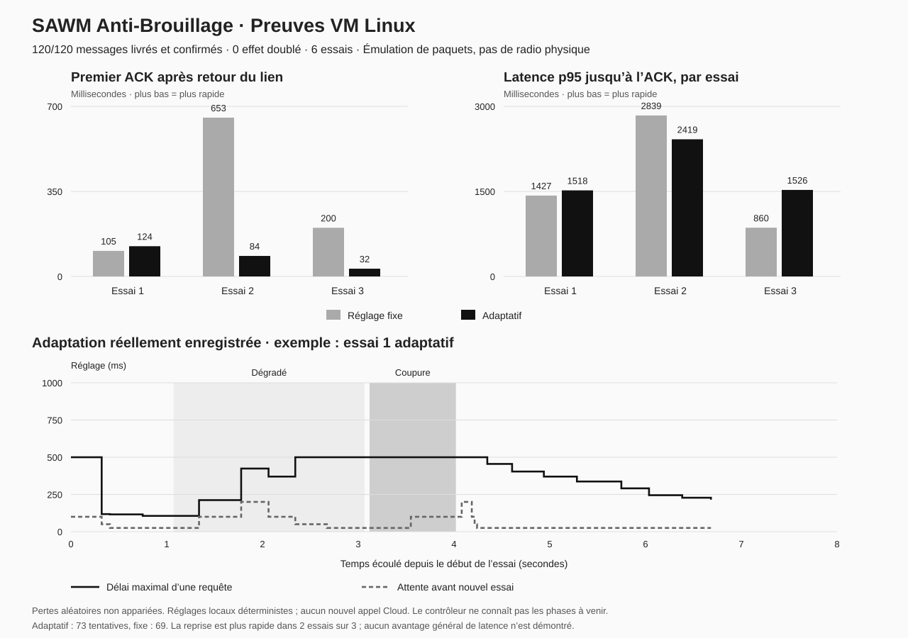

# Campagne VM Linux — 27 octobre 2026

**Six essais valides, 120 messages finalement livrés et acquittés, aucun effet dupliqué.** Cette campagne mesure une communication HTTP traversant un lien Linux soumis à des délais et à des pertes. Elle ne mesure aucune liaison RF.

[Rapport complet](report.json) · [Agrégats](aggregate.json) · [Guide technique](../GUIDE-TECHNIQUE.md#émulation-réseau-dans-une-vm-linux) · [Portée radio](../RADIO-VALIDATION.md)

## Protocole exécuté

La VM dispose de 2 vCPU et 3 Gio, avec Linux `6.8.0-138-generic` aarch64, Python `3.10.12` et `iproute2 5.15.0`. Deux namespaces réseau créés pour chaque essai sont reliés par une paire `veth`, sur `198.18.0.0/30`, sans route par défaut ni lien extérieur. Les règles `tc netem` sont appliquées **dans chaque sens** ; le réseau principal de la VM est conservé.

| Phase prévue | Paramètres injectés par sens |
| --- | --- |
| 0–1 s : nominal | Délai de 1 ms, aucune perte injectée |
| 1–3 s : dégradation | Délai de 60 ± 20 ms, 3 % de pertes aléatoires |
| 3–4 s : coupure | 100 % de pertes |
| Dès 4 s : reprise | Retour au délai de 1 ms, aucune perte injectée |

Chaque passage émet 20 messages synthétiques à intervalles prévus de 350 ms. Trois répétitions comparent les modes fixe et adaptatif, en alternant leur ordre. Les contenus, arrivées, limites et profils demandés sont identiques par paire ; les tirages aléatoires des pertes ne le sont pas. Le serveur et le worker restent actifs pendant les phases réseau.

La même [politique SAWM archivée](../measured-2026-10-27/cloud/policy.json) initialise les deux modes. Le contrôleur adaptatif ajuste localement ses paramètres à partir des seules tentatives terminées, sans connaître les prochaines phases. **Aucun nouvel appel Cloud n'a lieu.**

## Résultats des six passages

La campagne dure **46,001 s**. Chaque passage atteint 20 effets uniques et 20 ACK vérifiés, avec zéro effet dupliqué et zéro conflit de contenu. Les comptes par phase utilisent les instants réellement appliqués, conservés dans `phase-events.json`.

| Passage | ACK pendant dégradation | Effets / ACK en coupure stabilisée | Premier ACK après retour | Tentatives | p95 jusqu'à ACK |
| --- | ---: | --- | ---: | ---: | ---: |
| [r1 fixe](r1-static/report.json) | 4 | 0 / 0 | 105,35 ms | 22 | 1426,66 ms |
| [r1 adaptatif](r1-adaptive/report.json) | 4 | 0 / 0 | 124,44 ms | 24 | 1518,01 ms |
| [r2 fixe](r2-static/report.json) | 2 | 0 / 0 | 653,46 ms | 25 | 2839,41 ms |
| [r2 adaptatif](r2-adaptive/report.json) | 2 | 0 / 0 | 84,49 ms | 25 | 2418,93 ms |
| [r3 fixe](r3-static/report.json) | 5 | 0 / 0 | 200,27 ms | 22 | 859,73 ms |
| [r3 adaptatif](r3-adaptive/report.json) | 4 | 0 / 0 | 31,97 ms | 24 | 1525,90 ms |

Le premier ACK après retour est mesuré depuis la fin d'application du profil de reprise ; il ne mesure pas le vidage complet de la file. Le p95 part du début réel de la mise en file et se calcule séparément dans chaque passage. Les ACK d'une phase peuvent correspondre à des messages mis en file auparavant.

La fenêtre de coupure stabilisée commence **200 ms après la fin d'application** du profil de perte totale et se termine au début du retour. Aucun effet ni ACK n'y est enregistré dans les six essais. Les messages retenus sont livrés après rétablissement de la communication.

Un ACK en frontière est conservé dans `r3-static` : le message `0009` a été accepté **3,255 ms avant le début d'application de la coupure**, puis son ACK vérifié **62,825 ms après la fin de cette application**. La requête était déjà engagée ; cet événement précède la garde de 200 ms et ne prouve pas une communication à travers la coupure stabilisée.

## Conclusions et limites

Les confirmations continuent pendant la dégradation partielle, puis la livraison reprend après la coupure. Le résultat final complet ne signifie pas une communication maintenue pendant une perte stabilisée de 100 %.

Le mode fixe utilise **69 tentatives et 9 timeouts**, contre **73 tentatives et 13 timeouts** en adaptatif. Les moyennes des p95 jusqu'à ACK sont respectivement **1708,60 ms** et **1820,95 ms**. Pour l'acceptation chez le destinataire, elles sont **1669,23 ms** et **1572,28 ms** : cet horodatage est pris dans la transaction avant la fin du commit ; seul l'ACK confirme le commit terminé. Une acceptation plus précoce ou un premier ACK après retour plus rapide ne garantit donc pas une confirmation globale plus rapide. Trois répétitions, avec des pertes aléatoires non appariées, ne montrent pas de gain général du mode adaptatif.

Les compteurs Linux enregistrent **50 paquets supprimés** sur l'ensemble de la campagne, dont 15 déjà comptés avant l'application des coupures totales. Les traces du contrôleur adaptatif enregistrent des délais de requête de **70 à 500 ms** et des délais de reprise de **25 à 800 ms**. L'adaptation est donc exécutée et mesurée ; son bénéfice global reste à améliorer.

Il s'agit de vrais paquets TCP/HTTP dans une liaison virtuelle isolée, sans modèle de propagation, de modulation ou d'interférence RF. Aucun RSSI ou SNR n'est mesuré et aucun brouilleur n'est déployé. La politique initiale Cloud et les observations du contrôleur local ont des rôles distincts ; ces mesures ne démontrent pas un gain causé par un nouvel appel SAWM.



La figure est produite à partir des preuves enregistrées par le [script de rendu](../render_vm_figures.py).

## Reproduire

Dans une VM Linux disposant de Python 3.10+, `iproute2` (`ip`, `tc`), des namespaces réseau, de `veth` et de `netem`, depuis la racine du dépôt :

```sh
sudo python3 vm_netem_lab.py --output-dir output/vm-netem-reproduction --repetitions 3 \
  --policy docs/measured-2026-10-27/cloud/policy.json
```

Le répertoire de sortie doit être nouveau. Root sert au provisionnement et au nettoyage des ressources isolées. Une nouvelle exécution conserve son propre rapport et peut produire d'autres délais ou pertes ; elle ne doit pas écraser cette campagne.

La suite de validation du dépôt a passé **51 tests sur 51**. Ces tests et la campagne Linux sont des preuves complémentaires : un test unitaire ne remplace pas la circulation réelle des paquets dans la VM.

## Intégrité et contrôle après campagne

Les cinq contrôles globaux du [rapport](report.json) sont vrais : six passages terminés et valides, contenus identiques par paire, sources inchangées et durée sous le plafond. Les rapports individuels vérifient aussi l'isolement, les budgets, les contenus, la conservation du réseau principal et le retrait des ressources créées.

Les empreintes des quatre sources exécutées figurent dans `source_sha256`. Le [manifeste de campagne](manifest.json) conserve les SHA-256 des **80 fichiers bruts** de preuve : rapports, bases SQLite, messages, phases et journaux. Ce manifeste historique ne couvre pas les documents, figures et contrôles complémentaires ajoutés ensuite ; les originaux sont conservés.

Le [contrôle après redémarrage](postflight.json) confirme un HTTP **200** du service existant sur `8080/sante`, aucun namespace de test ni processus enfant restant, et un réseau conforme au relevé d'avant campagne. Ce contrôle de santé et de nettoyage ne valide pas la reprise d'une file à travers un redémarrage de machine.

Deux observations antérieures restent visibles : le [premier probe](postflight-initial-probe.json) a été interrompu par l'arrêt contrôlé de la VM ; la [première comparaison réseau](postflight-initial-comparison.json) affichait `false` parce qu'elle comparait des tuples Python à des listes JSON. Le contrôle corrigé normalise cette représentation avant comparaison et obtient `true` ; cet écart de type ne correspondait pas à une modification réelle du réseau.
